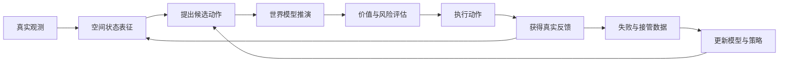

# 世界模型不只是会做梦：从空间智能到行动闭环

最近两年，“世界模型”几乎成了一个万能词。有人用它指能够生成长视频的模型，有人讨论的是机器人内部的动力学预测器，还有人把 3D 场景生成、游戏环境、自动驾驶仿真器乃至 JEPA 都放进这个篮子里。它们当然有联系，但解决的并不是同一个问题。

如果把青稞社区近期关于 Physical AI、空间智能、3D 生成、World-Action Model 和 VLA 的文章放在一起看，会发现一条比“谁的视频生成得更真”更清楚的主线：AI 正在尝试建立一个稳定的内部世界。这个世界需要保留空间结构，知道状态如何随时间变化，能够接受动作干预，还要在预测出错后用真实反馈修正自己。

换句话说，世界模型的终点不是一台会做梦的放映机，而是一个能参与行动的内部沙盘。

---

## 1. 先把“世界模型”这个词拆开

讨论世界模型，最容易犯的错误是把“预测未来”与“支持行动”混成一件事。

一个视频模型可以根据当前画面生成接下来的几秒：球滚下斜坡，杯子从桌边掉落，汽车驶过十字路口。它学习的是某种状态演化：

$$p(s_{t+1}\mid s_t)$$

如果模型进一步接收动作，例如方向盘转角、机械臂轨迹或智能体的移动指令，那么问题变成：

$$p(s_{t+1}\mid s_t,a_t)$$

第二个式子多了一个动作变量，意义完全不同。前者在问“世界接下来可能怎样变化”，后者在问“如果我这样做，世界会怎样变化”。只有后一个问题，才能支持反事实推演：左转会不会撞上障碍，夹爪再收紧一点会不会让杯子滑落，先挪开盘子是否能让后续动作更容易。

因此，在机器人和自动驾驶语境中，把动作条件视为世界模型的门槛是合理的。不过也不必陷入名词战争。视频预测器仍然可以学习大量运动与物理先验，它只是还没有完成从“观察世界”到“干预世界”的最后一步。

比定义更有用的是确认模型在系统中干什么。青稞社区转载的“World Model 四个象限”提供了一套很实用的坐标：一条轴区分离线训练和在线推理，另一条轴区分开环预测和闭环交互。

- 离线、开环的模型主要生成训练数据和视觉长尾场景。
- 离线、闭环的模型更像仿真器，允许策略反复试错。
- 在线、开环的模型给策略提供未来提示，但不参与多步搜索。
- 在线、闭环的模型会展开候选动作，预测后果，评分，再决定现实中执行哪一步。

真正困难的是最后一种。它要求世界模型足够快，也要求系统知道哪个未来更好。只会生成十种可能性没有用，还需要 Value Function、Progress Model 或其他目标函数把它们排出次序。

---

## 2. 空间智能不是“看懂一张图”

现在的视觉语言模型已经很会识别物体，也能回答“杯子在盘子的哪边”。问题在于，现实世界不是一张静态图片。

人在陌生房间里向左转身，门会从视野左侧移到右侧。门没有动，变化来自观察者的朝向。如果再向前走几步、绕过桌子、回到原地，理解这段经历需要持续更新位置、方向和物体关系。逐帧识别出“这里有一扇门”远远不够。

Physical AI 所需的表征至少包含几类信息：

1. 语义：画面里有什么，任务指令指向什么。
2. 几何：物体在哪里，相机朝向哪里，空间怎样延展。
3. 时序：什么发生了变化，变化由谁引起，先后顺序是什么。
4. 记忆：离开视野的物体仍然存在，重新回到旧位置时不能重新发明一套场景。

这四部分常被分散在不同研究方向里。VLM 擅长语义，3D 重建提供几何，视频模型处理时间变化，SLAM 或显式地图负责持久记忆。空间智能真正难的地方，是让这些信息进入同一个可更新的状态，而不是在若干互不相通的工具之间来回搬运。

### 2.1 Puffin-World：先让模型知道“上”在哪里

Puffin-World 处理了一个很基础、却经常被生成模型忽略的问题：相机在真实世界中朝向哪里。

很多多视角生成模型知道相机相对移动了多少，却没有稳定的绝对参照。相机发生大幅旋转后，地平线可能逐渐漂移，物体也会失去一致的直立方向。每一帧单独看都像真的，连起来却不是同一个物理空间。

Puffin-World 把世界拆成三种相互关联的状态：RGB 外观、深度几何，以及由重力场和纬度图描述的物理朝向。Omni-Camera 同时编码绝对方向与相对运动，使模型既知道“相机移动了多少”，也知道“移动以后在真实世界里朝向哪里”。

这个设计让单图相机理解、受控新视角生成、多视角深度预测和 3D 重建进入同一套模型。它目前主要处理静态场景，所谓“物理状态”也集中在重力与相机方向，还没有触及摩擦、碰撞、形变和接触。但它补上了一块重要底座：世界模型首先要拥有稳定坐标系，否则长轨迹预测很容易变成不断漂移的视觉幻觉。

### 2.2 Spatial-Interactor：从变化中学习空间

Spatial-Interactor 关注的不是场景生成，而是模型能否理解交互轨迹。它把训练任务安排成三个层级：先判断外部物体怎样变化，再理解自身运动怎样改变视角，最后把多次移动和转向整合为完整路径。

这套设计有一个很朴素的洞察：空间关系不是只靠观看学出来的，动作本身就是监督信号。观察 $o_t$、动作 $a_t$ 和下一次观察 $o_{t+1}$ 连在一起，模型才有机会区分“桌子被推走了”与“我绕到了桌子另一侧”。

团队构建了约 10.8 万条空间问答，并用监督微调加 On-Policy Distillation 训练。后者没有简单地给学生一份标准推理过程，而是在学生自己的推理轨迹上提供分段运动信息，帮助它找到漏掉的转弯或错误的位置更新。

这项工作的价值不在于又提高了几个空间问答分数。它改变了训练问题：不再只问模型“现在在哪里”，而是要求它说明“怎样到了这里”。这正是世界模型需要的状态转移意识。

### 2.3 Stream3D：记住最有用的视角，而不是所有历史

空间智能还面临一个现实问题：输入是无限流，内存不是。

Stream3D 为冻结的单图 3D 生成器增加了固定容量的证据记忆。它不会保存整段视频，也不直接传递越来越重的潜变量，而是为不同 3D token 记录最能解释该局部的历史视角。新帧只有提供了更强证据，才会替换旧记录。

这样一来，系统既像重建方法一样持续吸收真实观测，又能借助生成先验补全尚未看见的部分。它提示了一种更一般的空间记忆机制：长期记忆不必等于保存全部帧，关键是留下对当前世界状态不可替代的证据。

---

## 3. 预测未来，究竟应该预测什么

像素是最直接的监督，因为摄像机可以源源不断地提供视频。问题是，像素里混有大量与行动无关的细节：墙面的纹理、玻璃反光、阴影噪声、背景树叶的晃动。一个机器人要判断杯子是否会倒，不一定需要生成杯子表面每一道高光。

这形成了世界模型研究中的核心分歧：应该预测完整未来画面，还是预测一个更紧凑的未来状态？

### 3.1 像素预测的长处与代价

视频世界模型容易扩展。公开视频多，扩散和自回归训练路线成熟，模型还能继承丰富的视觉与语言先验。未来画面也便于人类检查：如果机械臂想象出自己穿过了桌面，我们一眼就能看出问题。

代价同样明显。高分辨率视频 token 很多，训练和推理都重；视觉上自然的运动也不等于动力学正确。一个生成视频可能让液体流得很漂亮，却无法保证体积守恒；可能画出合理的抓取结果，却改变了机器人的手指数目。

像素预测适合承载丰富先验，却不是控制可信度的保证。

### 3.2 PhiZero：把“长什么样”和“怎样变化”分开

PhiZero 提出“物理语言”，试图将状态转移压缩成离散符号。第一帧负责提供物体外观和场景身份，Physical Language Tokenizer 只记录后续发生了什么变化，再由扩散解码器把这种变化重新渲染成视频。

一段 4 秒、8 FPS、512×896 的视频，PhiZero 使用 256 个离散符号表达第一帧之后的状态转移；常规视频 VAE 需要约 44,800 个连续视觉 token。压缩带来的不只是速度想象，更重要的是表示解耦：同一种运动模式可以换一个物体、一个机器人本体或一个视觉域重新渲染。

它离真正的“物理语言”还有距离。离散 token 究竟学到了碰撞、支撑和流体规律，还是只学到了高效的运动编码，需要通过更严格的反事实控制和跨环境组合来验证。但 Reason-then-Render 的方向值得关注：先推理世界如何变化，再决定变化怎样呈现在像素上。

### 3.3 latent 不是越抽象越好

JEPA、Dreamer 和各类 latent world model 也在绕开像素重建。它们希望找到一个更可预测、更适合规划的状态空间。这里有个容易被忽略的条件：潜变量必须能被策略使用。

如果 latent 只在表征指标上好看，却无法回答动作后果、无法计算任务进度，也不能进入 planning loop，那么它仍然只是更好的视觉特征。一个有用的世界状态至少要保留任务相关几何、动作因果、不确定性和长期身份信息。

所以问题并不是“像素还是 latent”二选一，而是不同层级承担什么职责。像素可以负责丰富先验和可视化检查，3D 或对象状态负责持久结构，紧凑 latent 负责快速 rollout。成熟系统很可能同时拥有它们。

---

## 4. 当世界模型开始参与动作

VLA 的基本形式很直接：视觉观察和语言指令输入模型，模型输出动作。它的优势也是这种直接性。链路短、延迟低，在固定工位、桌面抓取和结构化仓储场景中很有竞争力。

纯 VLA 的麻烦出现在分布外状态。训练数据往往记录成功演示，却很少包含杯子滑落、抓取偏移、工具卡住或软物体意外形变。模型知道“应该抓起杯子”，却未必知道抓偏以后世界变成了什么，也不清楚下一步怎样恢复。

World-Action Model 试图把未来预测接入动作生成。目前大致有几种做法：

- 先生成未来视频或视觉子目标，再用逆动力学恢复动作。
- 在同一个 Transformer 或 Diffusion Transformer 中联合预测视频和动作。
- 训练时利用视频预测塑造动态表征，部署时跳过视频生成，直接输出动作。
- 用高层世界模型选择对象状态或子目标，低层 VLA、Diffusion Policy 或控制器负责执行。

这些路线没有谁已经胜出。显式视频计划容易检查，但慢；联合模型耦合更深，却可能让密集视频目标淹没稀疏动作信号；纯 latent 速度快，但可解释性和可验证性更弱；分层系统便于工程拆分，却需要处理模块之间的状态接口和误差传播。

### 4.1 EWAM 为什么值得看

EWAM 提供了一个少见的证据：世界预测分支不仅存在，而且真的影响动作。

它把视觉语言专家、视频专家和动作专家放进统一的 Flow-Matching DiT。动作 token 在每一层都可以读取语言、当前画面、预测的未来帧和自身历史，模型却没有接受“浅层理解、中层想象、深层执行”的人工监督。

训练后，分工自己出现了：浅层注意力主要落在视觉语言信息，中层转向预测的未来帧，深层则以动作自注意力为主。更重要的是干预实验。推理时屏蔽中层的未来帧，RoboTwin 成功率从 92.8% 降到 3.55%；把另一条成功轨迹的未来特征注入中层，机器人会跟随那个错误未来改变动作。

这说明未来预测不是装饰性的辅助损失。动作模型确实在利用“想象的后果”做决定。当然，EWAM 的分层模式仍然相对固定。真实任务未必都需要同样深度的想象：熟练动作可以快速反应，陌生局面则应投入更多 rollout。让计算随风险和不确定性动态分配，会是下一步更有意思的问题。

---

## 5. 闭环比“大一统”更重要

把所有模态塞进一个网络很诱人：图像、语言、深度、动作、触觉、奖励一起训练，期待统一模型自然涌现世界理解。但现实中的瓶颈往往不在模型名字，而在闭环能否运转。

一个完整的行动系统大致经历下面这条链路：

真正困难的部分至少有四个。

第一，世界模型会犯错，而且策略会主动利用它的错误。如果模型误以为机械臂可以穿过障碍，规划器可能反复选择这种“捷径”。因此 rollout 不能只有预测，还需要不确定性估计、安全约束和真实反馈校正。

第二，候选未来需要可靠的评分器。视频生成得逼真并不表示任务进度更高。倒水任务中的未来要判断液体是否进入杯中、是否溢出、杯子是否稳定；这些标准往往比生成本身更难标注。

第三，接触信息无法只靠 RGB 补全。夹爪是否夹稳、物体有没有滑动、力是否过大，都依赖触觉、力反馈和本体状态。只看视频的世界模型很容易在接触瞬间露馅。

第四，在线规划有严格延迟预算。机器人控制不能为了生成一段高清未来等上几秒。视频世界模型适合提供慢速高层计划，低层控制仍需要更快的策略和反馈回路。

这也是为什么 Dreamer 式思路一直有生命力。它关心的不是单独生成一段漂亮未来，而是 imagined rollout 能否转化为策略学习信号，智能体能否在模型内部试错，再用真实环境持续纠偏。大一统模型可能很远，闭环进化却已经有清楚的系统形状。

---

## 6. 3D 不会因为大模型出现就消失

有一种乐观判断认为，只要模型足够大，空间结构会自然藏进 latent，显式 3D 表示将变得多余。现阶段的证据并不支持这种结论。

当相机大幅运动、离开后重新回访、视频变长或需要从多个视角操作同一个物体时，纯隐式表示很容易出现身份漂移与结构遗忘。深度、相机位姿、点云、3D Gaussian、对象地图和 correspondence 不是旧时代遗留物，它们提供的是可检查的持久状态。

Puffin-World 把相机与深度变成生成模型的原生条件，Stream3D 用逐 token 证据记忆维持跨时间一致性，Spatial-Interactor 则从动作和轨迹中学习视角变化。这些工作看似分散，实际都在回答同一个问题：当当前画面消失以后，模型怎样知道世界仍然在那里？

显式 3D 不一定成为最终输出，也未必需要每一帧重建完整网格。但某种持久的空间骨架很难绕开。否则世界模型拥有的只是连贯画面，不是可以回访和干预的世界。

---

## 7. 未来系统可能长什么样

短期内，我不认为 VLA 会被世界模型取代。更可能出现的是分层混合系统：快策略负责高频执行，慢世界模型负责难例、规划和评估。

一个相对合理的结构是：

| 层级 | 主要职责 | 可能的技术形态 |
|---|---|---|
| 感知与状态层 | 语义、3D 几何、时序、对象身份与记忆 | VLM、VGGT 类模型、对象地图、流式记忆 |
| 预测层 | 预测动作导致的状态变化 | 视频世界模型、JEPA、latent dynamics、物理语言 |
| 规划与评价层 | 生成候选动作，判断进度、风险和约束 | Search、MPC、Value Model、Progress Model |
| 快速策略层 | 将指令和子目标转成动作块 | VLA、Diffusion Policy、Flow Policy |
| 控制与反馈层 | 稳定执行，处理接触与高频纠偏 | 力控、触觉、本体反馈、传统控制器 |

在熟悉、低风险的状态下，系统可以让 VLA 直接行动；遇到动态障碍、长程任务或失败恢复时，再调用世界模型做更多推演。世界模型也不必每次渲染高清 RGB，可以先在紧凑 latent 中筛选候选，只把少量关键未来解码出来检查。

这比“一个模型包打一切”麻烦，但更接近真实机器人的约束。机器人不是离线 benchmark，它需要在有限算力、真实延迟和物理风险中工作。

---

## 8. 几个判断

第一，空间智能的核心正在从静态识别转向状态维护。模型需要知道对象在哪里，也要知道对象为何到了那里、离开视野后是否还存在。

第二，世界模型的竞争重点会从视频质量转向可干预性。能否接受动作条件、支持反事实 rollout、表达不确定性，并为策略提供有效信号，比单纯延长视频更重要。

第三，像素生成、latent prediction 和显式 3D 不会很快统一成唯一表示。它们擅长的事情不同，未来几年更可能以分层方式共存。

第四，VLA 与世界模型之争多少是个伪问题。VLA 解决语义到动作的快速映射，世界模型负责预测与评估，低层控制处理接触和稳定性。通用机器人需要的是这几部分协同，而不是替其中一个名字宣布胜利。

最后，也是最现实的一点：世界模型真正的壁垒可能不是某个网络结构，而是数据飞轮。机器人部署以后，能否收集失败和人工接管，自动识别任务阶段与奖励，更新世界模型和策略，再安全地重新部署？谁先把这条闭环跑顺，谁才拥有持续增长的系统。

世界模型是否“理解物理”很难靠一段生成视频判断。更可靠的检验是把它放进行动循环：让智能体依据它做选择，允许预测被现实打脸，然后观察系统能不能从错误中变得更好。

---

## 参考阅读

### 概念与方向

1. [关于 Physical AI 第一性原理的思考：理解世界、预测世界、改造世界](https://www.qingkeai.online/blog/Physical-AI)
2. [谈论 World Model，请先对齐你的坐标！World Model 的四个象限](https://www.qingkeai.online/blog/World-Model-four-space)
3. [World Model 方向观察：大一统很远，闭环进化更近](https://www.qingkeai.online/archives/wm)
4. [VLA 已死？2026 年具身智能路线之争：World Model vs VLA](https://www.qingkeai.online/blog/2026-WorldModel-vs-VLA)

### 空间表征与持续记忆

5. [Puffin-World：从生成画面走向理解并构建物理可信世界](https://www.qingkeai.online/blog/Puffin-World)
6. [Spatial-Interactor：让大模型从运动和交互中学习空间推理](https://qingkeai.online/blog/Spatial-Interactor)
7. [Stream3D：打通流式 3D 重建与生成](https://www.qingkeai.online/blog/STREAM3D)

### 世界状态与行动

8. [PhiZero：用“物理语言”帮助世界模型理解世界](https://www.qingkeai.online/archives/PhiZero)
9. [预训练构建想象，微调驱动行动：World-Action Models 的崛起](https://www.qingkeai.online/blog/pretrained-to-imagine-fine-tuned-to-act-the-rise-of-world-action-models)
10. [EWAM：VLA 和世界模型放进一个网络，会打架还是分工？](https://qingkeai.online/blog/EWAM)
