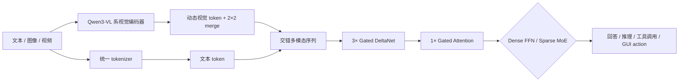

# Qwen3.5：原生多模态智能体与高效混合架构

## 基本信息

- **官方正式名称**：Qwen3.5，而不是独立的“Qwen3.5-VL”型号。Qwen3.5 本身就是原生视觉语言模型，所有正式 checkpoint 都直接命名为 `Qwen3.5-*`。
- **发布**：Qwen Team，2026-02-16；官方博客标题为 *Qwen3.5: Towards Native Multimodal Agents*。
- **首发模型**：Qwen3.5-397B-A17B，总参数 397B、每 token 激活 17B。
- **后续开放家族**：Dense 0.8B / 2B / 4B / 9B / 27B；MoE 35B-A3B / 122B-A10B / 397B-A17B。
- **模型类型**：Causal Language Model with Vision Encoder，支持文本、图像和视频统一输入。
- **上下文**：开放权重模型原生 262,144 token，可用 YaRN 外推至约 1,010,000 token；托管的 Plus/Flash 版本默认提供 1M 上下文。
- **许可证**：Apache-2.0。
- **资料性质**：截至 2026-10-20，官方尚未发布独立 arXiv 技术报告；本文主要依据官方博客、Hugging Face 模型卡、配置文件与 Transformers 实现说明，不能把它当作具有完整训练细节和受控消融的论文。
- **本地来源**：[sources.md](assets/Qwen3.5%20-%20原生多模态智能体与混合架构/sources.md)

## 一句话结论

Qwen3.5 把 Qwen3-Next 的 **3:1 Gated DeltaNet / full attention 混合解码器**与 Qwen3-VL 视觉编码器统一成原生多模态模型，再叠加高稀疏 MoE、Multi-Token Prediction、FP8 训练和大规模异步 RL；它最重要的变化不是“又一个 Qwen-VL”，而是取消文本模型与 VL 模型的产品分叉，让同一组权重同时承担文本、图像、视频、长上下文、工具调用和 GUI Agent。


> **图 1：Qwen3.5 官方发布页。** 官方标题直接使用“Qwen3.5：迈向原生多模态智能体”，而非 Qwen3.5-VL；这反映了视觉能力已从后缀分支升级为基础模型默认能力。  
> 来源：Qwen 官方发布页，2026-02-16，<https://qwen.ai/blog?id=qwen3.5>

---

## 1. 研究背景：为什么 Qwen3-VL 之后还需要 Qwen3.5

### 1.1 Qwen3-VL 已经解决了什么

Qwen3-VL 已经具备动态分辨率、Interleaved-MRoPE、DeepStack、多层视觉注入、显式视频时间戳、256K 原生上下文以及 Instruct/Thinking 双谱系。它把 Qwen-VL 路线推进到长文档、长视频、3D grounding 和 GUI Agent，详细分析见 [[Qwen3-VL - 长上下文视觉推理与智能体]]。

但 Qwen3-VL 仍然保持“纯文本 Qwen3”和“Qwen3-VL”两套产品与训练谱系。更重要的是，标准 Transformer 在 256K 文本、视觉 patch、视频帧和 Agent 工具历史共同出现时，full attention 的二次复杂度仍然昂贵；MoE 可以减少 FFN 激活参数，却不能解决所有层的 attention 成本。

### 1.2 Qwen3.5 的问题定义

Qwen3.5 的问题不是继续给 Qwen3-VL 增加单项视觉技能，而是回答：

> 能否让文本、图像和视频从预训练起就共享一个基础模型，同时把长上下文 attention、超大 MoE、视觉编码器和 Agent RL 的训练成本压到可扩展范围？

为此，Qwen3.5 同时改动四层：

1. **模型身份**：从独立 VL 分支转为默认原生多模态；
2. **文本骨干**：75% 层使用 Gated DeltaNet 线性注意力，25% 层保留完整注意力；
3. **容量结构**：旗舰采用 397B 总参数、17B 激活的高稀疏 MoE；
4. **训练系统**：FP8 多模态预训练与全异步 Agent RL。

这使它更接近“多模态 Agent 基座”，而不是传统意义上只做视觉问答的 VLM。

### 1.3 核心贡献

1. **统一视觉语言基础模型**：所有 Qwen3.5 checkpoint 都原生处理文本、图像和视频，不再需要寻找 `-VL` 后缀。
2. **高效混合注意力**：每 4 层采用 3 个 Gated DeltaNet 层和 1 个 Gated Attention 层，在长上下文效率与全局建模之间折中。
3. **高稀疏 MoE 家族**：旗舰 397B-A17B 使用 512 个专家，每 token 激活 10 个 routed experts 加 1 个 shared expert。
4. **原生长上下文与 Multi-Token Prediction**：开放权重模型原生 262K，并训练 MTP 以支持 speculative decoding。
5. **系统级多模态和 RL 扩展**：官方报告混合文本—图像—视频训练吞吐接近纯文本基线，FP8 使激活显存约减半；异步 RL 系统实现 3–5× 端到端加速。

---

## 2. 模型家族与输入输出

### 2.1 正式命名与模型谱系

| 类型 | 模型 | 总参数 / 激活参数 | 适用位置 |
|---|---|---:|---|
| Dense | 0.8B / 2B / 4B / 9B / 27B | 全参数激活 | 边缘、单机、多卡研究与部署 |
| MoE | 35B-A3B | 35B / 3B | 低激活成本的中型 MoE；对应托管 Flash 路线 |
| MoE | 122B-A10B | 122B / 10B | 中大型通用模型 |
| MoE | 397B-A17B | 397B / 17B | 首发旗舰；对应托管 Plus 路线 |

`A17B` 只表示每 token 激活规模，不等于只需存储 17B 参数。自部署仍需存放或分片全部 397B 专家权重，并承担专家路由和跨设备通信。

### 2.2 输入

Qwen3.5 统一接受：

- 纯文本和代码；
- 任意宽高比图像与多图序列；
- 视频；
- 交错图文/视频上下文；
- 工具返回、网页内容、GUI screenshot 和多轮 Agent 历史。

视觉预处理沿用 Qwen-VL 系列的动态分辨率思路。9B 配置显示：

- `patch_size=16`；
- `temporal_patch_size=2`；
- `spatial_merge_size=2`；
- 图像最长边像素预算为 $2^{24}$，最短边预算为 $2^{16}$；
- 图像归一化均值/方差均为 0.5。

### 2.3 输出

输出统一为自回归文本 token，可表示：

- 普通回答与显式 `<think>...</think>` 推理；
- OCR、文档 Markdown、代码与结构化结果；
- 目标位置、空间关系和视觉问答；
- 工具调用、GUI action 和 Agent 轨迹；
- 图像和视频内容理解结果。

Qwen3.5 默认启用 thinking mode，但不像 Qwen3 那样支持在提示中用 `/think`、`/nothink` 软切换；自部署时需通过 chat template 参数关闭思考。

---

## 3. 核心架构

### 3.1 总体数据流



Qwen3.5 并未从零重做所有组件。其组合关系是：

- **文本解码器**继承 Qwen3-Next 的 Gated DeltaNet 混合架构；
- **视觉编码器**继承 Qwen3-VL 的视觉塔；
- **位置编码**继续使用时间/高度/宽度三分量 Interleaved-MRoPE；
- **预训练**不再先做纯文本模型再外挂视觉，而是对交错文本、图像、视频 token 做 early fusion。

### 3.2 视觉编码器

9B 官方配置中的视觉塔为：

| 配置 | 数值 |
|---|---:|
| Depth | 27 |
| Hidden size | 1152 |
| Attention heads | 16 |
| Intermediate size | 4304 |
| Patch size | 16 |
| Temporal patch size | 2 |
| Spatial merge size | 2 |
| 输出维度 | 4096，与 9B 文本 hidden size 对齐 |

值得注意的是，9B 配置里的 `deepstack_visual_indexes=[]`。这说明 Qwen3.5 虽复用了 Qwen3-VL 视觉编码器和 Interleaved-MRoPE，但该 checkpoint 没有按 Qwen3-VL 技术报告中的方式启用 DeepStack 多层注入。当前公开材料没有给出受控实验解释为何取消或禁用 DeepStack，因此不能简单假定 Qwen3.5 完整继承 Qwen3-VL 的全部视觉融合设计。

### 3.3 3:1 Gated DeltaNet / Gated Attention

9B 模型有 32 层，按 8 组重复：

```text
Gated DeltaNet → FFN
Gated DeltaNet → FFN
Gated DeltaNet → FFN
Gated Attention → FFN
```

397B 旗舰为 60 层，即 15 个相同组。其意图是：

- **Gated DeltaNet** 用递归状态压缩历史，避免对所有历史 token 计算完整 $n\times n$ attention；
- **Gated Attention** 周期性恢复全局 token-to-token 交互，缓解纯线性注意力对精确检索与复杂组合关系的损失；
- 视觉 token、长视频和工具历史越多，这种混合结构的成本优势越明显。

官方报告，相对 Qwen3-Max，解码吞吐在 32K 上下文为 8.6×，在 256K 为 19×；相对 Qwen3-235B-A22B 则分别为 3.5× 和 7.2×。但官方没有披露绝对 tokens/s、GPU、batch size 和完整服务配置，因此这些数字适合证明趋势，不适合直接换算自己的部署吞吐。

### 3.4 高稀疏 MoE

397B-A17B 的官方配置为：

- 60 层、hidden size 4096；
- 512 个专家；
- 每 token 激活 10 个 routed experts + 1 个 shared expert；
- expert intermediate size 1024；
- Gated Attention 使用 32 个 Q heads、2 个 KV heads；
- Gated DeltaNet 使用 64 个 value heads、16 个 key heads。

17B 激活仅占总参数约 4.3%，但不能将其理解为显存或延迟也只剩 4.3%。全部专家权重、路由、共享层、视觉塔、KV cache 和 expert parallel 通信仍然存在。

35B-A3B 则有 256 个专家，每 token 激活 8 routed + 1 shared；这说明 Qwen3.5 的效率并非只依靠更少层，而是依靠高专家数、低单专家宽度和稀疏路由共同扩容。

### 3.5 Interleaved-MRoPE 与长上下文

Qwen3.5 继续使用多模态 RoPE，把旋转维度分配给时间、高度和宽度；9B 配置为 `mrope_section=[11,11,10]`，并设置 `mrope_interleaved=true`。相比把三个轴分成连续频率区间，交错分配使每个轴都获得低频长程信息和高频局部辨别能力。

开放权重模型原生上下文为 262,144 token。官方用 YaRN、`factor=4` 将其扩展到约 1,010,000 token；但 static YaRN 可能伤害短上下文性能，因此没有超长输入需求时不宜默认开启。

### 3.6 Multi-Token Prediction

配置中的 `mtp_num_hidden_layers=1` 表明模型训练了额外的 MTP 层，用于同时预测多个后续 token。推理框架可将它用作 speculative decoding，例如 vLLM 的 `qwen3_next_mtp`。MTP 的价值主要是减少串行解码等待，而非直接提高知识或视觉能力。

---

## 4. 原生多模态预训练与系统基础设施

### 4.1 Early fusion 的意义

Qwen3.5 官方称其从头在交错文本、图像和视频 token 上训练。与“先训纯文本 LLM，再接视觉 adapter”的路线相比，early fusion 使语言推理、视觉感知和 Agent 行为更早共享参数，减少文本能力与视觉能力分别优化后再对齐的割裂。

但官方博客未披露：

- 总预训练 token 数；
- 文本、图像、视频比例；
- 训练阶段与序列长度课程；
- 数据来源、去重、版权和合成数据比例；
- 优化器、学习率、batch、训练步数与总算力。

因此，官方“数十万亿 token”更准确地说是基础设施稳定扩展能力描述，不能直接当作模型的精确训练 token 数。

### 4.2 异构并行与 FP8

视觉编码器和语言/MoE 解码器的计算形态不同：前者以图像 patch 和 ViT 为主，后者涉及 GDN、full attention、专家路由和长序列。Qwen3.5 对不同组件使用不同并行策略，并重叠稀疏组件的计算，官方称混合文本—图像—视频训练吞吐接近纯文本基线。

FP8 pipeline 覆盖 activation、MoE routing 和 GEMM，对数值敏感层动态保留 BF16。官方报告：

- 激活显存降低约 50%；
- 训练速度提高超过 10%；
- 可稳定扩展到数十万亿 token。


> **图 2：官方基础设施说明。** Qwen3.5 不只优化网络结构，还通过异构并行、FP8 与异步 RL 管线提高多模态训练和 Agent rollout 的系统效率。  
> 来源：Qwen3.5 官方发布页“基础设施”章节截图，<https://qwen.ai/blog?id=qwen3.5>

### 4.3 大规模异步强化学习

官方后训练覆盖文本、多模态和多轮交互任务，采用训练—推理解耦的 fully asynchronous RL framework，并结合：

- 动态负载均衡；
- 细粒度故障恢复；
- FP8 端到端训练；
- rollout router replay；
- speculative decoding；
- multi-turn rollout locking；
- gradient staleness 和数据偏斜控制。

官方称端到端速度提高 3–5×，并可服务 million-scale agent scaffolds and environments。但没有公开 RL 算法、奖励配方、rollout 数、环境规模、KL/学习率和完整稳定性曲线。这里的主要贡献更像系统工程，而不是一套已可复现的 RL 算法。

---

## 5. 视觉推理、工具与 Agent

### 5.1 “Thinking with image”变成默认能力

Qwen3-VL 已探索 `think → act → analyze feedback → answer` 的视觉工具轨迹。Qwen3.5 把这种能力进一步融入通用模型：面对视觉问题时，模型可调用 Code Interpreter、图像搜索或浏览器工具，将图像转为可验证的中间结构，再继续推理。


> **图 3：迷宫视觉推理的中间过程。** 模型先用图像处理定位起点和终点，把非结构化图像转成可计算的 mask，而不是只凭语言直觉猜路径。  
> 来源：Qwen3.5 官方 Demo，<https://qwen.ai/blog?id=qwen3.5>


> **图 4：迷宫求解结果。** 在结构化网格上运行路径搜索并回写到图像，体现“视觉感知—代码工具—可验证结果”的闭环。  
> 来源：Qwen3.5 官方 Demo，<https://qwen.ai/blog?id=qwen3.5>

### 5.2 视觉数学和空间推理

Qwen3.5-397B-A17B 官方表中代表性成绩包括：MathVision 88.6、MathVista-mini 90.3、We-Math 87.9、RealWorldQA 83.9、RefCOCO avg 92.3、RefSpatialBench 73.6、OCRBench 93.1。视觉数学、OCR/文档与空间 grounding 是最突出的优势区域。


> **图 5：官方空间定位 Demo 的城市全景输入。** 这类宽视场、高密度场景要求模型在大量相似建筑和车辆中完成指代定位与相对方位判断，体现动态分辨率视觉输入对细粒度 grounding 的价值。  
> 来源：Qwen3.5 官方 Demo，<https://qwen.ai/blog?id=qwen3.5>


> **图 6：官方视觉数学输入示例。** 这类问题需要同时解析几何拓扑、接触关系和尺度约束，不能只依赖 OCR。模型卡将其作为 image input 的标准调用示例。  
> 来源：Qwen3.5 官方模型卡示例，<https://huggingface.co/Qwen/Qwen3.5-397B-A17B>

### 5.3 GUI 与 Visual Agent

旗舰在 ScreenSpot Pro、OSWorld-Verified、AndroidWorld 上分别报告 65.6、62.2、66.8。结果说明模型已从静态 grounding 进入桌面和移动端闭环操作，但并非全面领先：ScreenSpot Pro 与 OSWorld 仍低于页面列出的部分 Gemini/Claude 对照。

真实 Agent 性能还取决于截图分辨率、操作协议、工具返回截断、错误恢复、上下文管理和权限系统。视觉 grounding 分数高，不代表长程 Agent 一定可靠。

---

## 6. 实验结果与证据强度

### 6.1 旗舰视觉语言结果


> **图 7：官方视觉语言 benchmark 表局部。** Qwen3.5-397B-A17B 在 MathVision、MathVista、We-Math、ZEROBench 等视觉推理任务表现突出，但 MMMU / MMMU-Pro 并非表中第一。  
> 来源：Qwen3.5 官方发布页“视觉语言”章节截图，<https://qwen.ai/blog?id=qwen3.5>

| 能力 | 代表基准 | Qwen3.5-397B-A17B | 解读 |
|---|---|---:|---|
| 综合多模态 | MMMU | 85.0 | 强，但低于官方表中的 Gemini-3 Pro 87.2 |
| 视觉数学 | MathVision | 88.6 | 官方表中最高 |
| 文档 | OmniDocBench 1.5 | 90.8 | 官方表中最高 |
| OCR | OCRBench | 93.1 | 官方表中最高 |
| 空间 grounding | RefCOCO avg | 92.3 | 高于 Qwen3-VL 对照 |
| 长视频 | MLVU M-Avg | 86.7 | 官方表中最高 |
| 视频综合 | VideoMME 无字幕 | 83.7 | 低于 Gemini-3 Pro 87.7 |
| GUI Agent | OSWorld-Verified | 62.2 | 强，但仍低于 Claude 对照 |

这些结果支持“Qwen3.5 是强原生 VLM”，却不能将所有增益归因于混合架构。相对 Qwen3-VL，它同时改变了文本骨干、训练数据、early fusion、MoE 规模、RL、工具配置和基础设施，没有受控消融来分离各项贡献。

### 6.2 9B 的参数效率

Qwen3.5-9B 官方表将其与 Qwen3-VL-30B-A3B、GPT-5-Nano 和 Gemini-2.5-Flash-Lite 比较。在 44 个视觉语言项目中，它在绝大多数项目取得最高或并列最高：例如 MathVision 78.9、OmniDocBench 87.7、CountBench 97.2、VideoMME 有字幕 84.5、ScreenSpot Pro 65.2。

这说明提升并非只来自 397B 总容量；混合文本骨干、更强训练和多模态统一对中型 Dense 模型也有效。但官方没有提供同数据、同后训练、只替换架构的 Qwen3-VL vs Qwen3.5 对照，仍无法做严格因果归因。

### 6.3 工具条件影响结果

部分 benchmark 是“模型 + 工具系统”的联合成绩：

- BabyVision：52.3（Code Interpreter）/ 43.3（无工具）；
- V*：95.8（Code Interpreter）/ 91.1（无工具）；
- BrowseComp：69.0（context folding）/ 78.6（discard-all）。

因此比较时必须同时记录工具、上下文管理和提示设置。否则容易把 Agent scaffold 的收益误写成基础模型权重提升。

### 6.4 缺少受控消融

官方目前没有发布以下受控实验：

- 纯 full attention 对 3:1 GDN/full attention；
- Qwen3-VL 视觉塔有无 DeepStack；
- early fusion 对后装视觉对齐；
- MTP 对实际解码吞吐；
- MoE 专家数与 top-k；
- FP8 对 BF16 的质量和稳定性；
- 不同 RL 任务、奖励和异步程度；
- 262K 原生训练对 YaRN 1M 外推。

因此本笔记对架构的分析来自配置和系统描述，而不是论文式完整消融。

---

## 7. 与 Qwen3-VL 的关系

| 维度 | Qwen3-VL | Qwen3.5 |
|---|---|---|
| 产品定位 | 独立视觉语言模型系列 | 文本与视觉统一的默认基础模型 |
| 文本骨干 | Qwen3 Dense/MoE，主要 full attention | Qwen3-Next 式 3:1 GDN/full attention |
| 视觉塔 | Qwen3-VL ViT，带 DeepStack | 复用 Qwen3-VL 视觉塔；公开配置未启用 DeepStack |
| 多模态融合 | 视觉模型专项预训练 | 从头 early-fusion 文本/图像/视频 |
| 上下文 | 原生 256K，可外推 1M | 原生 262K，可外推约 1.01M |
| 模型形态 | Dense/MoE × Instruct/Thinking 两套 | 每个 checkpoint 默认可 thinking，也可参数关闭 |
| Agent | Reasoning/General/Tool RL | 更大规模异步文本、多模态、多轮 RL |
| 效率重点 | DeepStack、动态视觉、长上下文 | 线性注意力、超稀疏 MoE、MTP、FP8 |

Qwen3.5 并不是简单的“Qwen3-VL 3.5”。更准确的理解是：**Qwen3-VL 提供视觉塔与多模态位置表示，Qwen3-Next 提供高效文本解码器，Qwen3.5 将两条路线合并成统一基础模型。**

---

## 8. 局限与批判性评价

### 8.1 官方披露不足

最大的局限不是某一项 benchmark，而是截至当前没有完整技术报告。官方博客和模型卡没有公开：

- 总训练 token、数据配比和数据清洗；
- early fusion 的完整阶段、loss 和采样策略；
- 视觉塔是否冻结/何时解冻；
- 优化器、学习率、batch、训练硬件和成本；
- RL 算法、奖励、rollout 数与超参数；
- 关键组件的受控消融。

因此这是一套开放权重、部分开放配置的系统，而不是完全可复现的开放训练工程。

### 8.2 线性注意力不是免费午餐

Gated DeltaNet 将历史压缩进递归状态，长上下文成本更低，但这种压缩可能牺牲精确回看、任意 token 配对和多证据检索。每四层插入一次 full attention 是折中，不代表所有长上下文任务都能保持标准 attention 的精确性。官方 AA-LCR、LongBench v2 也并非表中最强，说明吞吐优势没有自动转化为所有长上下文任务的领先。

### 8.3 MoE 激活少，不等于易部署

397B-A17B 仍需要保存 397B 权重；512 专家和 top-10 路由带来 expert parallel 通信。原生 262K 又要求巨大 KV/cache 或线性状态、视觉 token prefill 和多轮输出。中小团队真正可用的通常是 4B/9B/27B 或托管 API，而不是旗舰本地部署。

### 8.4 1M 上下文属于外推

开放 checkpoint 原生 262K，约 1.01M 需要 static YaRN。外推可以扩大位置范围，却不能证明模型在 1M 上完成多跳、冲突证据和细粒度视频推理；还可能降低短文本性能。托管 Plus 默认 1M，也不能自动等同开放权重模型的原生训练长度。

### 8.5 Agent 可靠性和安全边界未系统披露

官方展示了浏览器、代码、GUI 与工具调用，但没有系统报告：

- Prompt Injection 与恶意网页指令；
- 越权调用、误删除和不可逆操作率；
- 多小时任务偏航、恢复和成本失控；
- 跨会话记忆和隐私；
- 医疗、自动驾驶等高风险视觉任务的部署边界。

因此 Qwen3.5 适合作为 Agent 基座，不应被理解为已经具备无人监督、长期自治的安全保证。

---

## 9. 复现与实践建议

### 9.1 选择模型

- **0.8B–4B**：端侧实验、领域微调、视觉抽取；
- **9B**：目前较平衡的单机/多卡 VLM 研究版本，官方视觉 benchmark 很强；
- **27B**：更强 reasoning，需要多卡或量化；
- **35B-A3B**：MoE 激活成本低，但仍需存放 35B 权重和支持 expert routing；
- **122B/397B**：适合大型集群或托管 API。

### 9.2 部署注意事项

1. Qwen3.5 需要最新 Transformers、vLLM 或 SGLang；旧稳定版可能没有完整架构支持。
2. DeltaNet 快速路径依赖 `causal_conv1d`、FLA 或优化 kernel；缺失时可能静默退回慢速 PyTorch 实现。
3. 批量生成使用 left padding。
4. 没有多模态需求时可启用 language-model-only，释放视觉 profiling 与 KV cache 资源。
5. 262K 上下文显存压力很大；若缩短，官方建议尽量保留至少 128K 以维护复杂 thinking 能力，但实际应按任务测量。
6. YaRN 只在确有超长输入时启用，避免短上下文质量回退。
7. 工具 Agent 评估同时记录成功率、步数、工具次数、token、延迟、人工接管率和错误恢复率。

### 9.3 最值得补做的研究实验

1. 在同一数据和训练预算下比较 Qwen3-VL full attention 与 Qwen3.5 3:1 GDN/full attention。
2. 单独恢复 Qwen3-VL 的 DeepStack，测试 OCR、小目标、文档和视觉数学是否改善。
3. 对 262K 原生、512K/1M YaRN 做 multi-needle、跨页、多证据和矛盾证据评测，而不只测试单针检索。
4. 将“无工具、代码工具、图像搜索、浏览器”分开报告，避免 Agent scaffold 淹没基础 VLM 能力。
5. 比较 Dense 27B 与 MoE 35B-A3B 的真实显存、TTFT、decode、路由通信和质量，而不只看激活参数。

---

## 10. 总结

Qwen3.5 的历史位置是结束“Qwen 文本模型”和“Qwen-VL”两条产品线分立：视觉不再是后缀，而成为所有基础模型的默认输入能力。架构上，它用 Qwen3-Next 的 Gated DeltaNet 混合解码器解决长上下文效率，用 Qwen3-VL 视觉塔和 Interleaved-MRoPE保留图像/视频结构，再以高稀疏 MoE、MTP、FP8 和异步 RL 扩大容量与 Agent 训练。

官方数据说明它在视觉数学、OCR、文档、空间 grounding 和中型模型参数效率上很强；但长上下文、视频和 GUI Agent 并非全面领先，且许多 benchmark 依赖 Code Interpreter、搜索与上下文管理。更关键的是，当前缺少独立技术报告和受控消融，训练数据与 RL recipe 也未公开。最严谨的结论不是“Qwen3.5-VL 全面替代 Qwen3-VL”，而是：

> Qwen3.5 将 Qwen3-VL 的视觉能力与 Qwen3-Next 的高效长上下文骨干合并为统一原生多模态模型；它代表产品和系统范式的转向，但其各项组件的独立贡献仍待完整技术报告验证。

---

## 11. 材料来源

- 官方发布：<https://qwen.ai/blog?id=qwen3.5>
- 官方模型家族：<https://huggingface.co/collections/Qwen/qwen35>
- 397B-A17B 模型卡：<https://huggingface.co/Qwen/Qwen3.5-397B-A17B>
- 9B 模型卡：<https://huggingface.co/Qwen/Qwen3.5-9B>
- 35B-A3B 模型卡：<https://huggingface.co/Qwen/Qwen3.5-35B-A3B>
- Transformers 架构说明：<https://huggingface.co/docs/transformers/main/model_doc/qwen3_5>
- 官方仓库：<https://github.com/QwenLM/Qwen3.5>
- 本地配置与图片溯源：[sources.md](assets/Qwen3.5%20-%20原生多模态智能体与混合架构/sources.md)
