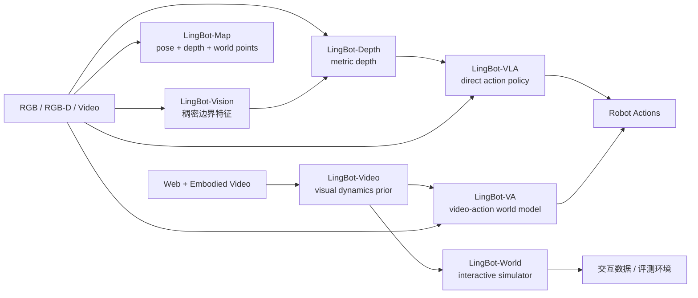

# LingBot 系列具身智能全栈：感知、建图、模拟与行动

## 基本信息

- **官方技术主页**：<https://technology.robbyant.com>
- **官方代码组织**：<https://github.com/Robbyant>
- **官方模型集合**：<https://huggingface.co/robbyant>
- **覆盖范围**：7 个模型家族、11 个公开版本节点；本文严格区分“家族—版本—checkpoint”，不把多个权重误算为多个独立模型。
- **系列定位**：从稠密视觉特征、度量深度与流式三维地图，到视频基础模型、交互世界模型、VLA 和视频—动作世界模型，构成“感知—建图—模拟—行动”的具身智能技术栈。
- **开源边界**：大多数 1.0 模型采用 Apache-2.0；World 2.0 改为 CC BY-NC-SA 4.0，且不发布完整 deployment code；VA 2.0 当前能确认的是项目页与技术报告，不能表述为已完整开放代码和权重。

---

## 1. High-level 结论

### 1.1 一句话结论

LingBot 不是一个把所有能力塞进同一参数体的“万能机器人模型”，而是一组围绕具身闭环分工协作的基础模型：**Vision/Depth 负责看清空间，Map 负责把瞬时观测变成持续地图，Video/World 负责想象环境如何演化，VLA 负责直接输出动作，VA 则把未来视频作为动作推理的中介。**

### 1.2 最重要的四个判断

1. **它是全栈，不是单模型。** 7 个家族之间共享教师、数据和方法，但没有证据表明它们已端到端联合成一个统一模型。
2. **2.0 的共同主题是“规模化 + 稀疏化 + 预测性”。** Depth 2.0 把 RGB-D 数据从 3M 扩到 150M；VLA 2.0 从 20K 小时扩到 60K 小时并引入 MoE action expert；World 2.0 用 causal KV cache 推向无限交互；VA 2.0 用 128-expert 视频 MoE 和 Multi-Chunk Prediction 扩大视觉动力学容量。
3. **空间感知不是外挂，而是跨模型教师。** LingBot-Vision 直接初始化 Depth 2.0；LingBot-Depth 又向 VLA 1.0/2.0 提供几何蒸馏目标。Map 暂未被公开证明直接接入 VLA，但它很适合作为后续可查询的持久空间状态。
4. **“开源”强度不一致。** Vision、Depth、Map、VLA、VA 1.0、Video 的代码/权重较完整；World 2.0 非商业许可且缺完整部署代码；VA 2.0 目前只应写“技术报告已公开”，不能写“完整模型已开源”。

### 1.3 七个家族总表

| 家族 | 核心问题 | 典型输入 | 典型输出 | 当前公开版本 | 在全栈中的角色 |
|---|---|---|---|---|---|
| LingBot-Vision | 如何学到边界清晰、空间敏感的视觉 token | RGB | 稠密 patch features | 1.0 | 通用稠密视觉编码器 |
| LingBot-Depth | 如何修复传感器空洞并恢复 metric geometry | RGB + raw depth + intrinsics | metric depth + point cloud | 1.0 / 2.0 | 度量空间感知 |
| LingBot-Map | 如何从无界视频流持续维护三维状态 | 单目 RGB 视频流 | pose + depth + world points | 1.0 | 在线地图与轨迹 |
| LingBot-Video | 如何学习通用且具身友好的视觉动力学 | 文本/图像/结构化条件 | 视频/动作结果模拟 | 1.0 | 通用视频基础模型 |
| LingBot-World | 如何生成可实时交互、长程一致的世界 | 初始帧 + camera/action/event | 可玩的未来视频流 | 1.0 / 2.0 | 交互环境模拟器 |
| LingBot-VLA | 如何把视觉语言直接映射为机器人动作 | 多视角视觉 + 指令 + state | action chunks | 1.0 / 2.0 | 直接策略 |
| LingBot-VA | 如何联合想象未来视频并产生动作 | 历史视觉 + 指令 + action context | future video + actions | 1.0 / 2.0 | 世界—动作联合模型 |

### 1.4 家族、版本与 checkpoint 的区别

- **家族**：例如 LingBot-VLA，是长期产品/研究方向。
- **版本**：例如 VLA 1.0 和 VLA 2.0，是方法、数据和系统发生明显变化的代际。
- **checkpoint**：例如 `lingbot-vla-v2-6b` 和 `lingbot-vla-v2-6b-robotwin`，是同一版本针对基础预训练或具体后训练任务发布的权重。
- **后缀不是新版本**：`-fast`、`-base`、`-posttrain-robotwin`、`-dense`、`-dmd` 说明速度、架构或后训练用途，通常不等于新一代模型。

---

## 2. 系列全景：从观测到闭环行动

### 2.1 分层关系

这张图表达的是**功能与教师关系**，不是官方已经公布的单一端到端训练图。可以确认的显式依赖是 Vision→Depth 2.0、Depth→VLA 1.0/2.0；Video/World/VA 在因果视频生成、KV cache、MoE 与蒸馏上技术同源，但不能据此宣称它们共享同一套权重。

### 2.2 两条主线

**空间状态线**：

$$\text{RGB}\rightarrow\text{boundary-aware features}\rightarrow\text{metric depth}\rightarrow\text{streaming 3D map}.$$

它解决“机器人现在在哪里、物体离多远、历史空间如何组织”。Vision、Depth、Map 的输出越来越接近显式几何状态。

**预测控制线**：

$$\text{video prior}\rightarrow\text{interactive world}\rightarrow\text{direct policy / video-action policy}.$$

它解决“下一步会发生什么、动作会造成什么结果、机器人应该怎么做”。Video/World 主要输出环境未来，VLA 直接输出动作，VA 同时建模未来视觉与动作。

---

## 3. LingBot-Vision 1.0：边界中心的稠密视觉表征

### 3.1 正式信息

- **论文**：*Vision Pretraining for Dense Spatial Perception*，arXiv:2607.05247。
- **核心方法**：Masked Boundary Modeling（MBM）。
- **最大模型**：ViT-g/16，约 1.1B 参数；SwiGLU、fp32 RoPE、4 register tokens，embedding dim 1536。
- **蒸馏家族**：Giant / Large / Base / Small，均为 backbone-only 权重。
- **许可证**：Apache-2.0。

### 3.2 它解决什么

语义自监督视觉模型倾向于让同类物体特征不变，却可能牺牲边界、细线和局部几何。MBM 不依赖人工边缘标签或外部 edge detector，而是在预训练过程中在线发现 boundary-bearing tokens，以亚像素距离场描述边界，再让模型恢复被遮蔽的稠密 token。目标不是只“认出杯子”，而是让特征变化落在杯子轮廓上。

### 3.3 关键结果

- NYUv2 冻结特征 + 线性深度头 RMSE **0.296**，优于 7B DINOv3 的 0.309。
- DAVIS / YouTube-VOS 无训练 label propagation J&F 为 **70.0 / 73.5**。
- ViT-L 学生约 0.3B，在 NYUv2 达 0.310，接近 7B DINOv3 的 0.309。

### 3.4 公开 checkpoint

| 官方模型 | HF 标识 | 定位 |
|---|---|---|
| Giant | `robbyant/lingbot-vision-vit-giant` | 最高质量，约 1.1B |
| Large | `robbyant/lingbot-vision-vit-large` | 官方推荐的性能/成本平衡 |
| Base | `robbyant/lingbot-vision-vit-base` | 中等部署预算 |
| Small | `robbyant/lingbot-vision-vit-small` | 轻量演示与下游 |

### 3.5 与系列的关系

LingBot-Vision 是 Depth 2.0 最明确的上游：只替换 Depth 编码器，并把 RGB-D 训练数据从 3M 扩到 150M，就显著降低深度补全误差。它说明系列内部不是“每个模型独立刷榜”，而是在建立可复用的空间视觉底座。

---

## 4. LingBot-Depth 1.0 / 2.0：从坏传感器中学习度量几何

### 4.1 任务与输入输出

- **论文**：*Masked Depth Modeling for Spatial Perception*，arXiv:2601.17895，ECCV 2026。
- **输入**：RGB `[B,3,H,W]`、可选 raw depth `[B,H,W]`、归一化内参 `[B,3,3]`。
- **输出**：metric depth `[B,H,W]` 与相机坐标点云 `[B,H,W,3]`。
- **许可证**：Apache-2.0。

### 4.2 Masked Depth Modeling

常规 MAE 随机挖洞；MDM 直接把真实 RGB-D 相机在玻璃、镜面、金属和低纹理区域产生的缺失深度当作掩码。由于这些洞不是随机噪声，而是物理成像失败的集中区域，模型被迫学习 RGB 外观、raw depth 与度量几何之间的关系。

### 4.3 1.0 与 2.0 的区别

| 维度 | Depth 1.0 | Depth 2.0 |
|---|---|---|
| 视觉编码器 | DINOv2 ViT-L/14 系 | LingBot-Vision ViT-L/16 与 ViT-g/16 |
| RGB-D 数据 | 3,019,200 对 | 150M 样本 |
| 重点 | 证明 MDM 与跨模态对齐 | scaling + 边界感知编码器 |
| 典型结果 | DIODE-Indoor block-mask RMSE 0.132 | 同项 0.062 |
| 开放状态 | 代码、数据、权重明确 | 方法与结果已公开；独立权重需以当前模型卡为准 |

3M 数据的明确构成是 RobbyReal 1,400,000、RobbyVla 580,960、RobbySim 999,264、RobbySimVal 38,976。2.0 的 150M 数字来自 Vision/Depth 2.0 官方说明，但当前 `lingbot-depth` README 的模型表仍主要列出 1.0 系权重，因此不能凭方法发布就虚构 2.0 checkpoint 名称。

### 4.4 当前仓库明确列出的 checkpoint

| checkpoint | 用途 | 备注 |
|---|---|---|
| `lingbot-depth-pretrain-vitl-14-v0.5` | dense/sparse raw depth 通用补全 | 推荐，修复 v0.1 bug |
| `lingbot-depth-pretrain-vitl-14` | 通用深度 refinement | v0.1 |
| `lingbot-depth-postrain-dc-vitl14` | sparse depth completion | 专项后训练 |

### 4.5 下游价值

Depth 不是单纯“补一张漂亮深度图”：它给 VLA 提供可蒸馏的 metric geometry，也可直接改善相机轨迹、4D point tracking 与透明/反光物抓取。VLA 1.0 的 RoboTwin Clean/Randomized 从无深度版 86.50%/85.34% 提升到深度版 88.56%/86.68%，说明几何监督能转化为动作成功率。

---

## 5. LingBot-Map 1.0：把三维状态变成可持续流

详细方法与代码级张量流见 [[LingBot-Map - 几何上下文流式三维重建]]，这里只说明它在系列中的角色。

### 5.1 核心方法

LingBot-Map 用 Geometric Context Attention 将历史拆成：

1. Anchor Context：前几帧完整 token，固定坐标和尺度；
2. Local Pose-Reference Window：最近 $k$ 帧完整 token，做稠密局部匹配；
3. Trajectory Memory：远历史每帧仅保留 camera、anchor、4 register，共 6 个摘要 token。

其上下文规模为：

$$n(M+6)+k(M+6)+6(T-n-k)=(n+k)M+6T,$$

而完整 causal history 为 $T(M+6)$。这不是严格常量内存，但把每帧远历史增长从约 $M+6$ 降为 6。

### 5.2 关键结果

- Oxford Spires 320 帧：ATE **5.37**；3840 帧：ATE **5.60**。
- ETH3D / 7-Scenes / NRGBD 点云 F1：**86.80 / 82.38 / 65.10**。
- GCA window 64 相比 full causal：ATE 5.98 vs 6.60，FPS 20.29 vs 11.87，显存 13.28 vs 36.06 GB。

### 5.3 checkpoint

- `lingbot-map`：主模型；
- `lingbot-map-long`：偏长序列；
- `lingbot-map-stage1`：Stage-1 双向几何基座，可接 VGGT 式推理，不是最终流式模型。

### 5.4 系列角色与边界

Map 把 Vision/Depth 的“每帧空间理解”推进成“跨时间持久空间状态”。但官方尚未证明 VLA/VA 已直接读取 Map memory。它无显式回环、BA 和动态层分解；万帧主要依赖 windowed VO 与 Sim(3) 拼接，不能等价为单状态无漂移运行万帧。

---

## 6. LingBot-Video 1.0：通用视觉动力学层

### 6.1 正式信息

- **论文**：*Scaling Mixture-of-Experts Video Pretraining for Embodied Intelligence*，arXiv:2607.07675。
- **架构**：Single-Stream Diffusion Transformer；视觉 latent 与条件 token 在同一序列中建模。
- **数据**：大规模 web video + **70,000+ 小时具身数据**。
- **许可证**：Apache-2.0。

### 6.2 为什么单独做 Video

Video 既服务通用生成，也学习动作进程、接触状态、环境反馈和任务结果。它和 World 的区别是：Video 更像可后训练的视频基础模型；World 则把相机/动作/事件控制、长程记忆和实时部署组合成可玩的交互系统。

### 6.3 MoE scaling

Sparse MoE 用共享专家与 top-K routed experts 替换 dense FFN。官方主模型标记 **30B-A3B**：总容量约 30B，每 token 激活约 3B；在 1M tokens 规模，项目页报告相对 Dense-30B 约 3.18× 速度收益。它强调“容量扩大但每 token 计算受控”，而不是让所有 30B 参数同时参与每个 token。

### 6.4 checkpoint

| checkpoint | 规模/方法 | 能力 |
|---|---|---|
| `lingbot-video-dense-1.3b` | Dense 1.3B | T2I / T2V / TI2V |
| `lingbot-video-moe-30b-a3b` | MoE 30B-A3B + Refiner | 高容量视频生成与 refinement |
| `lingbot-video-moe-dmd-30b-a3b` | MoE 30B-A3B，DMD 8-step | 少步快速 T2V / TI2V |
| `lingbot-video-rewriter-lora` | Qwen3.6-27B LoRA | prompt rewrite 辅助件，不是视频主模型 |

### 6.5 结果与边界

RBench Avg 为 **0.620**，Manipulation 0.578、Long-horizon 0.634、Quadruped 0.758。它证明具身数据能提升视频模型对机器人运动的模拟，但输出仍是视频，不是硬件可执行 action；若要形成策略，需要接 VLA、VA 或外部 inverse dynamics/policy head。

---

## 7. LingBot-World：交互式生成世界

### 7.1 World 1.0：动作可控分钟级视频世界

- **论文**：*LingbotWorld: Interactive World Modeling via Action-Controlled Video Generation*，arXiv:2601.20540。
- **底座**：Wan2.2；技术报告描述为 28B 双专家 MoE，每步激活约 14B。
- **训练/加速**：5→60 秒长程课程；Diffusion Forcing→Self-Forcing；Fast 版用因果分块与 KV cache。
- **输出**：480p/720p，Fast 系统声明 16 FPS、首段控制延迟低于 1 秒。
- **许可证**：Apache-2.0；v1 仓库已标记“不再积极维护”。

公开权重：

| 名称 | 控制 | 说明 |
|---|---|---|
| LingBot-World-Base (Cam) | camera poses | 基础相机控制模型 |
| LingBot-World-Base (Act) | actions | 动作控制模型；当前 README 的下载链接与 Cam 存在复用/不一致，应复核模型卡 |
| LingBot-World-Fast | camera poses | 因果蒸馏实时版 |

现有完整精读见 [[LingbotWorld - 动作可控交互世界模型]]。

### 7.2 World 2.0 / Infinity：从分钟视频到无界交互系统

- **论文**：*Infinite Worlds with Versatile Interactions*，arXiv:2607.07534。
- **规模**：14B 与 1.3B。
- **交互**：导航、事件、Pilot/Director、多用户协作 steering。
- **系统声明**：720p / 60 FPS / sub-second control latency；这是完整部署系统口径，不能直接当作公开 checkpoint 在普通脚本下的保证。
- **许可证**：CC BY-NC-SA 4.0，限制商业使用。

公开 checkpoint：

| checkpoint | 角色 |
|---|---|
| `lingbot-world-v2-14b-causal-fast` | 14B 快速因果模型 |
| `lingbot-world-v2-14b-causal-pretrain` | 14B 因果预训练模型 |
| `lingbot-world-v2-14b-bid` | 14B 双向模型 |
| `lingbot-world-v2-1.3b-causal-fast` | 1.3B 快速因果模型；包内主要是 DiT 权重，共用 T5/VAE/tokenizer assets |

### 7.3 World 1.0→2.0 的实质变化

| 维度 | 1.0 | 2.0 |
|---|---|---|
| 长度目标 | 分钟级上下文 | 无界/小时级交互叙事 |
| 控制 | 基础 camera/action | richer actions + Pilot/Director |
| 速度 | 480p 16 FPS 声明 | 720p 60 FPS 系统声明 |
| 模型 | 28B 双专家路线 | 14B/1.3B causal + bidirectional |
| 许可 | Apache-2.0 | CC BY-NC-SA 4.0 |
| 开放边界 | 代码/权重 | 推理代码/权重；完整 deployment code 明确不计划发布 |

作者仍把 true long-term memory、长时间复杂交互和 faithful physics 列为开放问题，因此“Infinity”更应理解为系统设计目标，而不是已解决无限时长无漂移。

---

## 8. LingBot-VLA：直接从语言与视觉到动作

### 8.1 VLA 1.0：大规模真实机器人数据基座

- **论文**：*A Pragmatic VLA Foundation Model*，arXiv:2601.18692。
- **规模/底座**：约 4B，Qwen2.5-VL-3B-Instruct。
- **数据**：20,000 小时真实机器人数据，覆盖 9 种主流双臂构型。
- **几何增强**：可学习视觉 query 对齐 LingBot-Depth embedding，训练时蒸馏，推理不必单独运行深度模型。
- **许可证**：Apache-2.0。

checkpoint：

| checkpoint | 深度蒸馏 | 用途 |
|---|---:|---|
| `lingbot-vla-4b` | 否 | 基础预训练 |
| `lingbot-vla-4b-depth` | 是 | 基础预训练 |
| `lingbot-vla-4b-posttrain-robotwin` | 否 | RoboTwin 后训练 |
| `lingbot-vla-4b-depth-posttrain-robotwin` | 是 | RoboTwin 后训练 |

RoboTwin Clean/Randomized：无深度 **86.50%/85.34%**，深度版 **88.56%/86.68%**。真实机器人平均 Success Rate 从无深度 16.20% 到深度版 16.87%，增幅较小但 Progress Score 从 34.32% 到 35.16%。这说明几何蒸馏有效，但不是所有动作瓶颈都由深度决定。

### 8.2 VLA 2.0：一脑多机与预测性感知

- **论文**：*From Foundation to Application: Improving VLA Models in Practice*，arXiv:2607.06403。
- **规模/底座**：约 6B；Qwen3-VL-4B-Instruct + sparse MoE action expert。
- **数据**：50,000 小时机器人轨迹（20 种构型）+ 10,000 小时 egocentric human video。
- **统一动作空间**：55 维。
- **许可证**：Apache-2.0。

55 维具体分配：

$$14_{\text{arm}}+14_{\text{EEF}}+2_{\text{gripper}}+12_{\text{hand}}+4_{\text{waist}}+2_{\text{head}}+3_{\text{mobility}}+4_{\text{reserved}}=55.$$

**MoE Action Expert** 让共享专家承载通用运动先验，routed experts 学习本体/任务差异；**Dual-Query Distillation** 同时加入 current 与 future queries，分别从 LingBot-Depth 和 DINO-Video 获取当前几何与未来语义动力学监督。它比 1.0 只补“当前空间”更进一步，开始把“未来会怎样”蒸进直接策略。

checkpoint：

| checkpoint | 用途 |
|---|---|
| `lingbot-vla-v2-6b` | native-depth 基础预训练权重 |
| `lingbot-vla-v2-6b-robotwin` | RoboTwin 2.0 50 任务后训练权重 |

结果：

- RoboTwin Clean / Randomized：**93.52% / 92.80%**；
- 1.0 对应为 88.56% / 86.68%；
- RTX 4090D、10 denoising steps，官方 real-robot policy 单次调用约 130 ms。

### 8.3 VLA 1.0→2.0 的实质变化

| 维度 | 1.0 | 2.0 |
|---|---|---|
| 数据 | 20K h robot | 50K h robot + 10K h ego |
| 本体 | 9 种双臂 | 20 种，含单/双臂、半人形、人形、移动 |
| 动作 | 双臂为主 | 55D 全身统一表示 |
| 基座 | Qwen2.5-VL-3B | Qwen3-VL-4B |
| expert | 常规 action expert | sparse MoE action expert |
| 蒸馏 | current depth | current/future Depth + DINO-Video |
| 模型 | 4B | 6B |

---

## 9. LingBot-VA：让未来视频成为动作中介

### 9.1 VA 1.0：让视频预测与动作输出闭环

- **论文**：*Causal World Modeling for Robot Control*，arXiv:2601.21998，RSS 2026。
- **范式**：自回归 diffusion + Mixture-of-Transformers，把 video tokens 与 action tokens 交错建模。
- **三阶段闭环**：未来视频生成 → IDM 解码动作 → 执行后用真实观测替换/回灌 video KV cache。
- **许可证**：Apache-2.0。

公开 checkpoint：

| checkpoint | 角色 |
|---|---|
| `lingbot-va-base` | shared-backbone 基础模型 |
| `lingbot-va-posttrain-robotwin` | RoboTwin 后训练 |
| `lingbot-va-posttrain-libero-long` | LIBERO-LONG 后训练 |

当前官方仓库明确公开的是 **shared-backbone** 版本及后训练代码。2026-01-29 News 写的是“separated version 敬请期待”，并未宣布 separated 已发布，也不能把 separated 直接等同于 VA 2.0。

### 9.2 VA 2.0：具身原生视频—动作预训练

VA 2.0 不再把通用视频生成器事后改造成控制器，而是从 tokenizer、因果骨干、容量分配和目标函数开始围绕机器人控制重设计。

#### 9.2.1 四个核心模块

1. **Semantic Visual-Action Tokenizer**：视觉 tokenizer 对齐冻结感知编码器；IDM/FDM 从相邻视觉 latent 自监督提取 latent actions，让压缩空间保留对控制有用的语义与动力学。
2. **Causal Video-Action Pretraining**：因果 DiT 在语言与 planner context 下联合预测未来视觉 latent 与 latent action，训练信息结构贴近部署。
3. **Mixture-of-Experts Video Stream**：视频流 128 experts、top-8 routing；动作流保持 dense，把额外容量花在高维视觉动力学而不是低维 action decoding。
4. **Multi-Chunk Prediction**：同时预测未来第 1/2/3 个 action-video chunk，缓解只看下一小步的近视与 rollout 误差累积。

#### 9.2.2 Foresight Reasoning

预测、执行与真实观测 re-grounding 异步重叠：机器人执行当前 chunk 时，模型已经准备未来 latent；新观测到达后先用 FDM 重接 cache，再预测当前动作结果和下一动作。官方还结合 consistency distillation、FP8 TensorRT、长上下文 attention 优化和 runtime amortization，宣称端到端 4×+ 加速，并展示 30/60/150 Hz 控制档位。

#### 9.2.3 开放状态必须谨慎表述

- 官方项目页链接到 `Robbyant/lingbot-va` 内的 VA2 技术报告 PDF；
- 该仓库 README、公开 checkpoint 与代码说明仍对应 VA 1.0 shared-backbone；
- 当前未发现官方 VA 2.0 checkpoint 名称、独立代码发布 News 或明确许可证；
- 因此准确写法是：**VA 2.0 技术报告与项目演示已公开；完整代码/权重尚不能确认已公开。**

### 9.3 VLA 与 VA 不是重复命名

| 维度 | VLA | VA |
|---|---|---|
| 动作路径 | 视觉/语言表征直接条件化 action expert | 先/同时想象未来视觉，再解码动作 |
| 计算重点 | 语义理解、跨本体动作统一 | 视觉动力学、长时记忆、闭环 re-grounding |
| 优势 | 延迟可控、部署路径直接 | 未来可解释、数据效率与长历史潜力 |
| 风险 | 可能缺显式未来建模 | 视频生成成本高，想象误差可能污染动作 |
| 2.0 方向 | MoE action expert + 双查询蒸馏 | 视频 MoE + native tokenizer + Multi-Chunk + async foresight |

VLA 2.0 通过 DINO-Video future query 向 VA 靠近；VA 2.0 则通过高频异步执行向 VLA 的实时控制靠近。两条路线正在收敛，但尚未合并为同一模型。

---

## 10. 跨模型依赖与复用

### 10.1 明确公开的依赖

| 下游模型 | 上游模型/教师 | 用法 |
|---|---|---|
| Depth 2.0 | Vision | 替换 DINOv2 encoder 初始化 |
| VLA 1.0 | Depth | 三视角 learnable query 对齐 depth embedding |
| VLA 2.0 | Depth + DINO-Video | current/future dual-query distillation |
| Map | DINOv2-Large / VGGT 风格骨架 | patch encoder 与交替注意力几何基座 |
| World 1.0/2.0 | Wan2.2 | 视频生成/因果世界模型底座 |
| VA 1.0 | video diffusion + IDM | 未来视频与动作联合建模 |

### 10.2 尚未被公开证明的连接

1. Map memory 是否直接输入 VLA/VA；
2. Vision 是否替换 Map 的 DINOv2 encoder；
3. Video checkpoint 是否直接初始化 World 2.0 或 VA 2.0；
4. World rollout 是否用于 VLA 的正式数据闭环；
5. 七个模型是否存在统一 token space 或共享训练框架。

这些连接在研究上合理，但截至本文核查材料只能当作潜在路线，不能写成官方事实。

---

## 11. checkpoint 与开源矩阵

| 家族/版本 | 代码 | 权重 | 训练/后训练 | 许可证 | 主要限制 |
|---|---:|---:|---:|---|---|
| Vision 1.0 | ✅ | ✅ 4 档 backbone | 训练头未随 backbone 权重发布 | Apache-2.0 | checkpoint 为 backbone-only |
| Depth 1.0 | ✅ | ✅ 3 档 | 数据 3M 已发布 | Apache-2.0 | v0.1 有 bug，优先 v0.5 |
| Depth 2.0 | 方法/报告 ✅ | 独立权重需核模型卡 | 150M recipe 未完整复现 | 沿项目公开信息核查 | 不应虚构 checkpoint |
| Map 1.0 | ✅ | ✅ 3 档 | 完整预训练难复现 | Apache-2.0 | 64 GPU 级训练，含内部数据 |
| Video 1.0 | ✅ | ✅ 3 主模型 + rewriter | 推理资源齐全 | Apache-2.0 | 30B-A3B 部署成本高 |
| World 1.0 | ✅ | ✅ Base/Fast | 仓库停止积极维护 | Apache-2.0 | 多 GPU、长时漂移 |
| World 2.0 | 基础推理 ✅ | ✅ 4 档 | deployment code ❌ | CC BY-NC-SA 4.0 | 非商业；完整 60 FPS 系统不可等价复现 |
| VLA 1.0 | ✅ | ✅ 4 档 | post-train/toolchain ✅ | Apache-2.0 | 主要围绕双臂构型 |
| VLA 2.0 | ✅ | ✅ base + RoboTwin | post-train/deploy ✅ | Apache-2.0 | 6B + 多教师依赖，真机仍需本体适配 |
| VA 1.0 | ✅ shared backbone | ✅ 3 档 | post-train ✅ | Apache-2.0 | separated 版本未明确发布 |
| VA 2.0 | 未确认 | 未确认 | 技术报告/演示 ✅ | 未确认 | 不能称完整开源 |

---

## 12. 发布时间线

按官方项目页与仓库的公开节奏，LingBot 在 2026 年形成两轮发布：

| 日期 | 节点 | 意义 |
|---|---|---|
| 2026-01-27 | Depth 1.0 | 从传感器空洞切入空间感知 |
| 2026-01-28 | VLA 1.0 | 20K 小时真实机器人基础策略 |
| 2026-01-29 | World 1.0 | 动作可控交互世界 |
| 2026-01-30 | VA 1.0 | 视频预测与机器人动作联合 |
| 2026-04-16 | Map 1.0 | 补齐持久在线三维状态 |
| 2026-07-07 | Vision 1.0 / Depth 2.0 | 空间视觉 backbone 与 150M RGB-D scaling |
| 2026-07-08 | VLA 2.0 | 60K 小时、20 本体、55D、MoE |
| 2026-07-09 | World 2.0 / Video 1.0 | 无界交互系统与通用视频基础模型 |
| 2026-07-10 | VA 2.0 | 具身原生视频—动作预训练 |

第一轮先铺“能看、能做、能模拟”；第二轮则把底层视觉、数据规模、MoE 和实时系统补齐。

---

## 13. 批判性评价与研究启发

### 13.1 真正的技术主线

**第一条：把空间监督向动作端蒸馏。** Vision 学边界，Depth 学 metric geometry，VLA 用 query distillation 吸收当前/未来感知。推理时未必需要串联所有模型，但训练时用空间教师塑造策略表征。

**第二条：用稀疏专家把容量放到最需要的模态。** Video 把 MoE 放到视频 DiT 的 FFN；VLA 2.0 把 MoE 放到 action expert；VA 2.0 只稀疏扩视频流而保持动作流 dense。三者共同回答的不是“要不要 MoE”，而是“哪种 token 的复杂度值得额外容量”。

**第三条：从单步预测转向持续闭环。** Map 的 streaming cache、World 的 causal chunks、VA 的真实观测 re-grounding、VLA 的 action chunks 都在把离线大模型改造成在线系统。

### 13.2 最值得借鉴的设计

1. **分层记忆优于单一缓存**：Map 的 anchor/local/trajectory 三层状态可迁移到 VLA 历史建模。
2. **teacher 只在训练时出现**：Depth/DINO-Video query distillation 把强感知蒸进 VLA，避免部署时级联多个大模型。
3. **容量按模态分配**：VA 2.0 的“视频 MoE、动作 dense”比全模型无差别扩容更符合输入输出复杂度。
4. **真实观测重接想象状态**：VA 的 re-grounding 是防止世界模型 rollout 漂移污染控制的关键。
5. **统一动作空间不是简单补零**：55D 表示只是接口，真正的跨本体能力还依赖 embodiment conditioning、MoE specialization、数据平衡与每台机器人标定。

### 13.3 仍未闭合的全栈缺口

1. **Map 没有成为 action policy 的显式可查询空间记忆**；
2. **World 尚未形成公开可复现的 VLA synthetic-data / policy-evaluation 闭环**；
3. **VA 2.0 的代码和权重开放状态不足以支持独立复现**；
4. **World 2.0 的 720p/60 FPS 依赖未公开完整 deployment stack**；
5. **系列缺一个统一评测协议**，无法公平回答“直接 VLA 与 video-action VA 哪条路线在同数据同算力下更优”；
6. **动态三维状态仍弱**：Depth/Map 更偏静态几何，World/VA 更偏像素动力学，显式 4D object state 尚未成为共同中间层。

### 13.4 对后续研究的直接启发

一个自然的后续系统可以是：

$$\text{Vision/Depth}\rightarrow\text{Map memory}\rightarrow\text{VA foresight}\rightarrow\text{VLA action expert},$$

其中 Map 提供可回环的对象级/几何级持久状态，VA 负责候选未来的视觉动力学 rollout，VLA 负责低延迟 action decoding；World 则作为离线数据引擎与安全评估环境。真正困难的不是把模块串起来，而是让它们共享不漂移、可更新、可对齐到动作的中间状态。

---

## 14. 最终评级

| 家族 | 评级 | 理由 |
|---|---:|---|
| Vision | ★★★★☆ | 边界中心预训练思路清楚，稠密任务强；训练数据和完整 recipe 复现门槛仍高 |
| Depth | ★★★★☆ | MDM 直击真实传感器失败，跨模型价值高；2.0 权重开放边界需继续核查 |
| Map | ★★★★☆ | GCA 的几何分层记忆很有启发；无显式回环，超长程依赖窗口拼接 |
| Video | ★★★★☆ | 首批面向具身的开源 MoE 视频底座，数据与模型齐；视频指标到控制价值仍有距离 |
| World | ★★★★☆ | 实时交互系统方向完整；2.0 非商业且部署栈不完整公开 |
| VLA | ★★★★★ | 数据、跨本体、几何/未来蒸馏、后训练与部署链最完整，是当前最可用分支 |
| VA | ★★★★☆ | 范式前沿，闭环与记忆潜力大；VA 2.0 复现材料不足 |
| **全系列** | **★★★★★** | 少见地覆盖感知—建图—模拟—行动完整链，并形成明确内部教师关系；价值在“系统谱系”而非每项都单独绝对领先 |

---

## 15. 官方来源

| 模型 | 项目页 | 论文/报告 | 代码 |
|---|---|---|---|
| Vision | <https://technology.robbyant.com/lingbot-vision> | <https://arxiv.org/abs/2607.05247> | <https://github.com/Robbyant/lingbot-vision> |
| Depth | <https://technology.robbyant.com/lingbot-depth> | <https://arxiv.org/abs/2601.17895> | <https://github.com/Robbyant/lingbot-depth> |
| Map | <https://technology.robbyant.com/lingbot-map> | <https://arxiv.org/abs/2604.14141> | <https://github.com/Robbyant/lingbot-map> |
| Video | <https://technology.robbyant.com/lingbot-video> | <https://arxiv.org/abs/2607.07675> | <https://github.com/Robbyant/lingbot-video> |
| World 1.0 | <https://technology.robbyant.com/lingbot-world> | <https://arxiv.org/abs/2601.20540> | <https://github.com/Robbyant/lingbot-world> |
| World 2.0 | <https://technology.robbyant.com/lingbot-world-v2> | <https://arxiv.org/abs/2607.07534> | <https://github.com/Robbyant/lingbot-world-v2> |
| VLA 1.0 | <https://technology.robbyant.com/lingbot-vla> | <https://arxiv.org/abs/2601.18692> | <https://github.com/Robbyant/lingbot-vla> |
| VLA 2.0 | <https://technology.robbyant.com/lingbot-vla-v2> | <https://arxiv.org/abs/2607.06403> | <https://github.com/Robbyant/lingbot-vla-v2> |
| VA 1.0 | <https://technology.robbyant.com/lingbot-va> | <https://arxiv.org/abs/2601.21998> | <https://github.com/Robbyant/lingbot-va> |
| VA 2.0 | <https://technology.robbyant.com/lingbot-va-v2> | <https://github.com/Robbyant/lingbot-va/blob/main/LingBot_VA2_paper.pdf> | 当前未确认独立代码/权重发布 |
