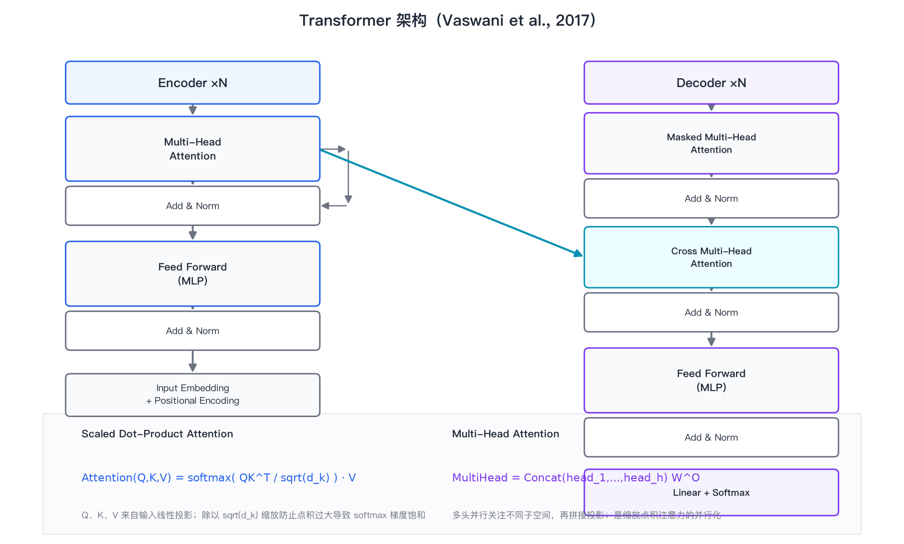
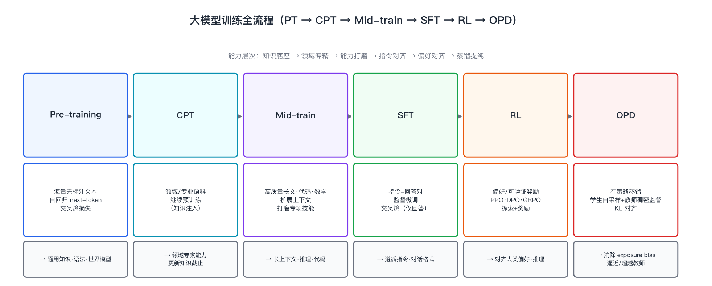
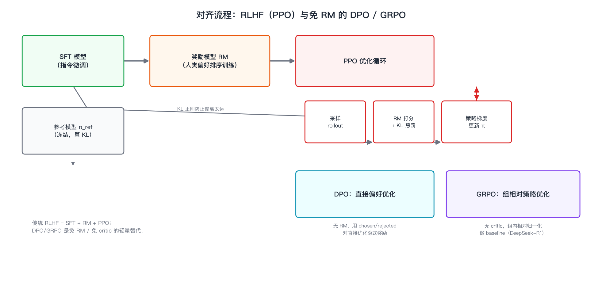
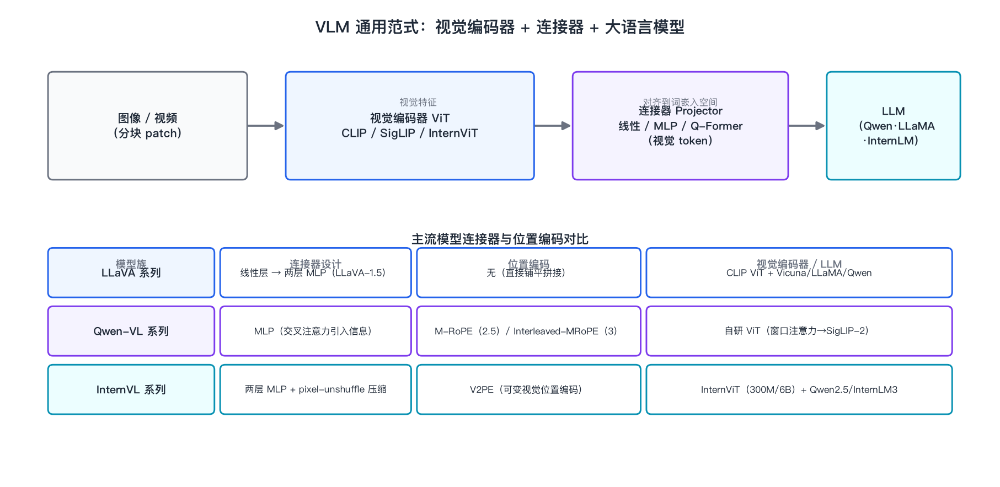
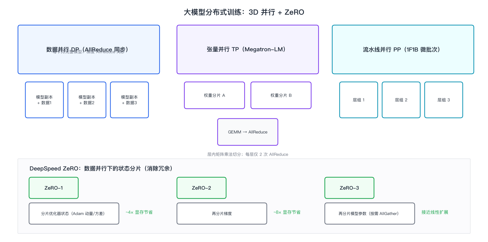
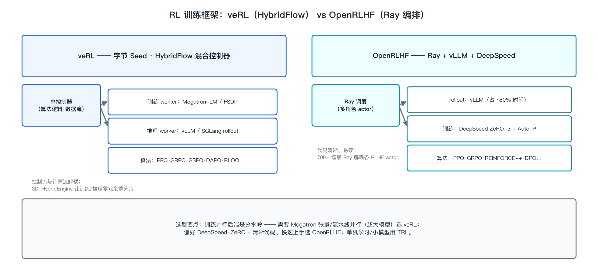

# 多模态大模型架构与训练全流程

## 基本信息

- **领域**：VLM / 基础模块
- **类型**：领域综述（Survey）
- **主题**：Transformer 架构原理、大模型训练全流程（CPT / Mid-train / SFT / RL / OPD）、主流 VLM 架构（LLaVA / Qwen-VL / InternVL）、分布式训练框架（Megatron-LM / DeepSpeed）、强化学习对齐框架（veRL / OpenRLHF）
- **写作时间**：2026-08-25
- **定位**：作为"旭涛的技术视野"知识沉淀的体系化综述，把多模态大模型从底层架构到训练、对齐、分布式落地的完整技术栈串成一条可复用的认知主线。

---

## 1. 研究背景：从 Transformer 到多模态大模型

要讲清楚多模态大模型，得先回到它唯一的计算底座——Transformer。今天几乎所有 VLM（视觉语言模型）、视频生成模型、乃至 3D 生成模型，其主干都是同一个东西：一个用自注意力机制堆叠起来的深度网络。理解 Transformer 的注意力计算，是理解后面"为什么 VLM 要把图像编码成 token"、"为什么分布式训练要把矩阵乘法切开来"这些问题的起点。

### 1.1 Transformer 架构原理

Transformer 由 Vaswani 等人在 2017 年的《Attention Is All You Need》中提出，最初用于机器翻译，但它真正的价值在于彻底抛弃了 RNN 的串行递归，把序列建模变成了纯并行的矩阵运算。一个 Transformer 由 Encoder 与 Decoder 两个对称的堆叠模块组成（现代仅解码器的 LLM 只保留 Decoder 一侧），每个模块内部是两条固定的子层：多头自注意力（Multi-Head Attention）与位置前馈网络（Feed-Forward Network），两条子层外都包着一层残差连接和 LayerNorm。

自注意力的核心是缩放点积注意力（Scaled Dot-Product Attention）。给定输入序列的 Query、Key、Value 三个矩阵，注意力分数由 Query 与 Key 的点积、缩放、softmax 归一化、再与 Value 加权求和得到：

$$
\text{Attention}(Q,K,V)=\text{softmax}\!\left(\frac{QK^{T}}{\sqrt{d_k}}\right)V
$$

其中除以 $\sqrt{d_k}$（$d_k$ 是 Key 的维度）这一步至关重要：点积的方差会随维度线性增长，导致 softmax 输入落入饱和区、梯度趋近于零，缩放操作把方差拉回 1，让训练稳定。多头注意力（Multi-Head Attention）则是把 $Q,K,V$ 投影到 $h$ 个不同的低维子空间并行计算注意力，再把各头输出拼接、投影回去：

$$
\text{MultiHead}(Q,K,V)=\text{Concat}(\text{head}_1,\dots,\text{head}_h)\,W^{O}
$$

多头的意义在于让不同头关注不同类型的关系——有的头关注位置临近性，有的头关注句法依存，有的头关注指代关系。图 1 给出了完整的架构示意图。

*图 1：Transformer 架构（Vaswani et al., 2017）。左侧 Encoder 与右侧 Decoder 都由多头注意力 + 前馈网络构成，外部包残差连接与 LayerNorm；底部给出了缩放点积注意力与多头注意力的计算公式。图中青绿色箭头表示 Encoder 输出作为 Key/Value 喂入 Decoder 的交叉注意力（Cross Attention），这是 Encoder-Decoder 架构信息传递的关键路径。来源：自绘，公式引自原论文。*

Encoder 与 Decoder 的差异在注意力掩码：Decoder 的自注意力是**掩码（Masked）**的，即位置 $i$ 只能看到 $i$ 及之前的位置，保证自回归生成时不会"偷看未来"；而 Encoder 与 Decoder 之间的交叉注意力允许 Decoder 的 Query 去查询 Encoder 的所有 Key/Value，从而把源序列信息注入目标序列。

对 LLM 而言，训练目标就是自回归的 next-token 预测：给定前文 $x_{<t}$，最大化下一个 token $x_t$ 的条件概率，损失是交叉熵：

$$
\mathcal{L}=-\sum_t \log P(x_t \mid x_{<t})
$$

这一句"预测下一个词"看似简单，却是后续所有能力——语法、世界知识、推理、代码、工具使用——的涌现来源。理解了这一点，就能理解后面 VLM 为什么只是"在词表之外，再塞进一堆视觉 token"。

### 1.2 从纯文本到多模态：VLM 的通用范式

一个 VLM 本质上就是把"视觉"这一新的模态接入 LLM 的 next-token 预测框架。做法高度统一，几乎所有的 VLM 都遵循三段式结构：

1. **视觉编码器（Vision Encoder）**：通常是一个 ViT（Vision Transformer），把输入的图像/视频切成 patch，编码为一串视觉特征；
2. **连接器（Projector / Connector）**：把视觉特征投影到 LLM 的词嵌入空间，常见的有线性层、两层 MLP、Q-Former 或 pixel-unshuffle 下采样；
3. **大语言模型（LLM）**：接收"视觉 token + 文本 token"的拼接序列，按自回归方式生成回答。

这个范式的精妙之处在于：它没有改动 LLM 本身，而是把视觉"翻译"成 LLM 已经会处理的 token 语言。视觉编码器负责"看懂"，LLM 负责"推理与表达"，连接器负责两者之间的"语言对齐"。训练上一般分两阶段：第一阶段冻结 LLM 只训练连接器（有时连同视觉编码器）做**模态对齐**，第二阶段再做指令微调。图 2 展示了这一数据流，图 3 是通用范式加上三大主流模型族的对比。

---

## 2. 大模型训练全流程：PT → CPT → Mid-train → SFT → RL → OPD

现代大模型的训练早已不是"预训练 + 微调"两步这么简单，而是演化为一条分工明确的多阶段流水线。每一阶段解决一类特定的能力问题，阶段之间有严格的先后依赖。图 2 把六个阶段串成了完整链条。

*图 2：大模型训练全流程（PT → CPT → Mid-train → SFT → RL → OPD）。每个阶段上方是训练数据与目标，下方是该阶段产出的能力。整体遵循"知识底座 → 领域专精 → 能力打磨 → 指令对齐 → 偏好对齐 → 蒸馏提纯"的能力层次递进。来源：自绘。*

### 2.1 Pre-training（预训练）

预训练是整个体系的底座。在海量无标注文本（数万亿 token）上，用自回归 next-token 预测 + 交叉熵损失，让模型学到通用语法、世界知识、常识与初步的推理模式。这一阶段最贵、最慢，决定了模型的"智力上限"。预训练数据经过严格的去重、质量过滤、毒性过滤，并精心配比不同来源（网页、书籍、代码、学术论文、百科）。

### 2.2 CPT（Continued Pre-Training，继续预训练）

CPT 是在预训练基座之上，用**领域/专业语料**继续做 next-token 预测，把模型"补课"成某个领域的专家。典型场景是：通用模型要变成法律助手、医疗助手、代码专家，或者要更新知识截止日期（把 2024 年之后的知识灌进去）。CPT 与预训练用的是同一种损失，区别在于数据规模更小、领域浓度更高、学习率更保守，以避免灾难性遗忘——训练新领域知识时把旧能力冲掉。

### 2.3 Mid-train（中期训练）

Mid-train 是 CPT 之后、SFT 之前的能力打磨阶段，用**高质量长文、代码、数学、推理数据**去扩展上下文长度、打磨专项技能。它的核心目标不是注入新知识，而是把已有能力"磨锋利"：让模型能处理超长上下文、写出更完整的代码、做出多步数学推理。很多模型在这一阶段引入合成数据（用强模型生成难题与解答）和课程学习（从易到难）。Mid-train 是近年才被正式命名和重视的阶段，被视为"从会到精"的关键跳板。

### 2.4 SFT（Supervised Fine-Tuning，监督微调）

SFT 把模型从"会续写"变成"会对话、会听指令"。数据是精心构造的指令-回答对（instruction-response），损失仍然是交叉熵，但**只对回答部分的 token 计算损失**，指令部分的 token 不参与梯度反传——这是 SFT 与预训练在实现上最关键的差异。SFT 之后模型学会了对话格式、遵循指令、拒绝不当请求，但它的回答质量仍取决于训练数据的分布，无法自行判断"什么样的回答更好"。

### 2.5 RL（Reinforcement Learning，强化学习对齐）

RL 阶段解决的是"对齐"问题：让模型不仅会回答，而且回答符合人类偏好——有用、无害、诚实。最经典的路线是 RLHF（Reinforcement Learning from Human Feedback），它通常包含三个组件：SFT 模型作为初始策略、一个用人类偏好排序训练出来的**奖励模型（Reward Model, RM）**、以及用 PPO 做策略优化的循环。PPO 的目标是最大化奖励，同时用 KL 散度约束新策略不要偏离参考模型太远：

$$
\max_{\theta}\ \mathbb{E}_{x\sim\mathcal{D},\,y\sim\pi_\theta}\big[r(x,y)\big]-\beta\,\text{KL}\big(\pi_\theta(y|x)\,\|\,\pi_{\text{ref}}(y|x)\big)
$$

PPO 需要同时维护策略模型、参考模型、奖励模型、价值模型四个网络，训练复杂且不稳定。为此出现了一批免 RM、免 critic 的轻量替代（图 5）：

- **DPO（Direct Preference Optimization）**：把 RLHF 的"先训 RM 再 PPO"两步合为一步，直接在 chosen/rejected 偏好对上用隐式奖励做优化，不需要显式奖励模型，实现简单、稳定；
- **GRPO（Group Relative Policy Optimization）**：DeepSeek-R1 采用的方法，去掉 critic（价值模型），对同一个 prompt 采样一组回答，用组内相对得分做 baseline，大幅降低显存开销。

*图 5：对齐流程。左侧是传统 RLHF 三件套（SFT + RM + PPO 循环），PPO 循环内含"采样 rollout → RM 打分 + KL 惩罚 → 策略梯度更新 π"的闭环，参考模型 π_ref 提供 KL 正则防止偏离太远；右下角是免 RM 的 DPO 与免 critic 的 GRPO 两种轻量替代。来源：自绘。*

### 2.6 OPD（On-Policy Distillation，在策略蒸馏）

OPD 是训练流水线最新的一环，也是这条链里最容易被误解的术语。它的正式名称是 **On-Policy Distillation（在策略蒸馏）**，核心思想是：用一个更强的**教师模型**来训练一个更小的**学生模型**，但关键在"在策略"三个字——学生模型在**自己的采样轨迹（rollout）**上做生成，教师模型对这条轨迹提供 **token 级的稠密 log-prob 监督**，学生最小化与教师分布之间的 reverse KL 散度。

为什么强调"在策略"？传统的知识蒸馏（离线蒸馏）用教师提前生成的静态数据训练学生，学生训练时看到的是教师分布、推断时却面对自己的分布，二者不一致会产生 **exposure bias（曝光偏差）**——误差会在自回归生成中逐 token 累积放大，理论分析表明偏差量级约 $O(\varepsilon T^2)$（$\varepsilon$ 是单步误差，$T$ 是序列长度）。而 OPD 让学生在**自己的** rollout 上对齐教师，误差被降到约 $O(\varepsilon T)$，几乎线性而非平方增长。通俗地说：离线蒸馏是"背教师的答案"，OPD 是"让学生自己答题、教师逐题批改"，后者才能真正逼近乃至超越教师。

OPD 已被 Qwen 3.6/3.7、DeepSeek-V4、GLM-5.1 等一线模型采用，作为 RL 之后的"蒸馏提纯"环节。在 veRL 框架里，OPD 有两种具体实现变体：**GKD OPD**（Generalized Knowledge Distillation，广义知识蒸馏）与 **PG OPD**（Policy Gradient OPD，策略梯度式）。它是理解"小模型如何逼近大模型"这一当下产业最关心问题（降本 + 保持质量）的钥匙。

---

## 3. 主流 VLM 架构：LLaVA / Qwen-VL / InternVL

三大 VLM 家族都遵循第 1.2 节的通用范式，但各自的演进路线、连接器设计、位置编码方案差异显著。图 3 把它们放在一起对比。

*图 3：上排是 VLM 通用数据流（图像分块 → 视觉编码器 ViT → 连接器 Projector → LLM），下排是 LLaVA / Qwen-VL / InternVL 三大模型族在连接器设计、位置编码、视觉编码器与 LLM 四个维度的对比。来源：自绘。*

### 3.1 LLaVA 系列：最简洁的范式开创者

LLaVA（Large Language and Vision Assistant）是"线性连接器 + 冻结 LLM"这一最简范式的开创者，其最大贡献在于**证明了只用极简的投影层，就能让 LLM 获得不错的视觉能力**。它的演进脉络清晰：

- **LLaVA（1.0）**：用单层线性层把 CLIP ViT 的视觉特征投影到 LLM 词嵌入空间，训练分两阶段——先冻结 ViT 与 LLM 只训练线性层做对齐，再指令微调；
- **LLaVA-1.5**：把单层线性换成**两层 MLP**，引入更强的数据配比与分辨率，性能大幅跃升，成为后续无数工作的基座；
- **LLaVA-NeXT（1.6）**：引入 **AnyRes 动态分辨率**，把高分辨率图像切成多个子图分别编码再拼接，解决固定分辨率导致的小目标与文本识别短板；
- **LLaVA-OneVision**：把单图、多图、视频统一进同一个接口，朝"任意视觉输入"的通用助手演进。

LLaVA 的价值在于"做减法"：它告诉我们，VLM 的下限可以很低，一条线性投影就能打通视觉与语言，这让多模态能力得以快速扩散到各种 LLM 基座上。

### 3.2 Qwen-VL 系列：从任务专用到原生多模态

Qwen-VL 是阿里通义的多模态旗舰，演进节奏快、架构创新密集，每一代都在解决一个明确痛点：

- **Qwen-VL（初代）**：用 MLP 连接器 + 交叉注意力引入视觉信息，但仍是相对独立的视觉分支；
- **Qwen2-VL**：引入 **M-RoPE（Multimodal Rotary Position Embedding）**，用 3D 位置编码同时编码"时间（视频帧）+ 高度 + 宽度"三个维度，让视频理解与图像理解统一起来；
- **Qwen2.5-VL**：把视觉编码器换成**窗口注意力 ViT**，兼顾高分辨率细节与计算效率；
- **Qwen3-VL**：全面升级为 **SigLIP-2 视觉编码器 + Interleaved-MRoPE（交织 M-RoPE）+ DeepStack**，并推出 **MoE 235B-A22B** 版本——"235B 总参数、每次激活 22B"，用稀疏激活把模型规模推上百亿到千亿量级的同时控制推理成本。这是当下"大而快"的典型范式。

Qwen-VL 路线的核心思路是"把多模态做原生"：不是把视觉当外挂，而是从位置编码、视觉编码器、到 MoE 主干都围绕多模态原生设计。

### 3.3 InternVL 系列：原生多模态预训练与可变位置编码

InternVL（上海 AI Lab / OpenGVLab）的差异化在于**训练理念**：它强调"原生多模态预训练"——不把视觉对齐当作 LLM 训练之后的事后补丁，而是在预训练阶段就联合文本与多模态数据做单阶段训练。

- **InternVL（早期）**：ViT-MLP-LLM 结构，并率先提出用大视觉编码器（InternViT，6B）配合 LLM；
- **InternVL3**：三个关键点——① **原生多模态预训练**（ViT-MLP-LLM 单阶段联合训练，而非先训 LLM 再对齐）；② **V2PE（Variable Visual Position Embedding，可变视觉位置编码）**，支持长多模态上下文；③ 后训练用 **SFT + MPO（Mixed Preference Optimization，混合偏好优化）**。InternVL3-78B 在 MMMU 上取得 72.2 分，刷新开源 MLLM 标杆。

InternVL 的启示在于：视觉与语言的融合越早越好，把多模态能力"焊进"预训练，比事后对齐更稳固。

### 3.4 三者的本质对比

抛开细节，三条路线的分野可以概括为一句话：**LLaVA 极简、Qwen-VL 原生、InternVL 预训练融合**。LLaVA 证明下限可以很低、便于快速复刻；Qwen-VL 用位置编码与 MoE 把多模态推向"大而快"；InternVL 用原生预训练追求"深而稳"。选择哪条路线，取决于你是要快速起一个基线、还是要工业级原生多模态、还是要理论上的融合上限。

---

## 4. 分布式训练框架：Megatron-LM 与 DeepSpeed

当模型参数量达到百亿、千亿级时，单卡显存（甚至单机多卡）根本装不下，训练必须跨成百上千张 GPU 并行。这里有两套主流方案：**Megatron-LM 的 3D 并行**与 **DeepSpeed 的 ZeRO**。图 4 给出了两者的原理示意。

*图 4：大模型分布式训练。上半部分是 3D 并行三剑客——数据并行 DP（每卡持完整模型、梯度 AllReduce 同步）、张量并行 TP（层内矩阵乘法切分、每层仅 2 次 AllReduce）、流水线并行 PP（按层分组、1F1B 微批次调度）；下半部分是 DeepSpeed ZeRO 的三种状态分片等级（ZeRO-1 分片优化器状态、ZeRO-2 再分片梯度、ZeRO-3 再分片模型参数按需 AllGather）。来源：自绘。*

### 4.1 Megatron-LM：3D 并行

NVIDIA 的 Megatron-LM 把并行拆成三个正交的维度：

- **数据并行（Data Parallelism, DP）**：每张卡持有一份完整的模型副本，各自处理不同的数据切片，反向传播后梯度做 AllReduce 同步。这是最基础的并行，但每张卡都要装下完整模型，无法解决"模型太大装不下"的问题；
- **张量并行（Tensor Parallelism, TP）**：把单个 Transformer 层内的矩阵乘法在多个 GPU 上切分——例如把权重矩阵按列或按行切开，每张卡算一部分再汇总。TP 的通信发生在层内，每层只需要 2 次 AllReduce，通信量小，适合单机内高速互联（NVLink）；
- **流水线并行（Pipeline Parallelism, PP）**：把模型按层切成若干段，每张卡负责一段，像工厂流水线一样处理微批次。为避免流水线空转，采用 **1F1B（one-forward-one-backward）** 调度——每个 worker 交替做前向和反向，让 GPU 尽量不闲着。

实践中三者叠加使用：**机内用 TP（高速互联）+ 机间用 PP（减少跨机通信）+ 全局用 DP（扩展吞吐）**。这正是"百亿/千亿参数大规模训练经验"的核心工程直觉：并行策略的选择本质是在**计算、显存、通信**三者之间做权衡。

### 4.2 DeepSpeed：ZeRO 显存优化

微软的 DeepSpeed 走的是另一条路——它不改变数据并行"每卡一份模型"的前提，而是把**冗余的中间状态分片**，把省下来的显存换成更大的模型。ZeRO（Zero Redundancy Optimizer）分三级：

- **ZeRO-1**：分片**优化器状态**（Adam 的一阶动量、二阶方差），显存节省约 4 倍；
- **ZeRO-2**：在 ZeRO-1 基础上再分片**梯度**，约 8 倍；
- **ZeRO-3**：再分片**模型参数本身**，每张卡只存自己的参数分片，前向时按需 AllGather 收集，接近线性的显存扩展——理论上能让任意大的模型在任意多卡上跑起来。

ZeRO 的核心洞察是：数据并行里每张卡存的优化器状态、梯度、参数是**完全冗余**的，把这些冗余分片，显存就能被几乎全部用于模型本身。ZeRO-3 与 Megatron 的 TP/PP 也常结合使用，各取所长。

### 4.3 大规模训练的经验要点

把两套框架放一起看，百亿/千亿规模训练的关键经验可以归纳为几条：**显存是第一约束**（用 ZeRO-3 或 TP+PP 消解）；**通信是第二约束**（梯度同步、参数聚合都要尽量留在机内高速互联上）；**并行策略是动态权衡**（TP 通信密集适合机内，PP 有气泡适合大模型，DP 吞吐高但受显存限制）；此外还有混合精度（BF16/FP16 + 梯度缩放）、梯度检查点（用计算换显存）、3D-HybridEngine（训练与推理权重的零冗余重分片）等配套技术。这些不是零散技巧，而是一套围绕"如何把一块放不下的模型，高效地训练出来"的系统工程。

---

## 5. 强化学习对齐框架：veRL 与 OpenRLHF

第 2.5 节讲的 RL 对齐算法，要在百亿/千亿规模真正跑起来，离不开专门的训练框架。RL 训练的特殊性在于它是一个**"训练 + 推理"的混合流水线**：既要前向采样 rollout（推理），又要反向传播更新策略（训练），两个环节的硬件需求完全不同，因此框架的核心挑战是**如何编排训练 worker 与推理 worker**。主流方案有两套：字节 Seed 的 veRL 与开源的 OpenRLHF。图 6 对比了两者架构。

*图 6：veRL 与 OpenRLHF 架构对比。veRL 采用 HybridFlow 混合控制器，把控制流与计算流解耦，训练 worker 用 Megatron-LM/FSDP、推理 worker 用 vLLM/SGLang，3D-HybridEngine 实现训练/推理零冗余重分片；OpenRLHF 用 Ray 编排多角色 actor，rollout 用 vLLM（约占 80% 时间），训练用 DeepSpeed ZeRO-3 + AutoTP。底部小结：选型分水岭在训练并行后端——超大模型（需 Megatron 张量/流水线并行）选 veRL，偏好 DeepSpeed-ZeRO + 清晰代码快速上手选 OpenRLHF，单机学习用 TRL。来源：自绘。*

### 5.1 veRL：HybridFlow 混合控制器

veRL 是字节跳动 Seed 团队开源的 RL 训练框架，它的核心贡献是 **HybridFlow 混合控制器**：用**一个单一的控制器**同时管理"算法逻辑"与"数据流"，把**控制流与计算流解耦**。这意味着算法工程师可以专注写算法，框架自动把训练负载调度到 Megatron-LM/FSDP 的 worker、把推理负载调度到 vLLM/SGLang 的 rollout worker。其 **3D-HybridEngine** 能让模型在训练与推理两种角色之间切换时**零冗余重分片**——RLHF 里模型一会儿要前向采样（推理）、一会儿要反向更新（训练），如果每次切换都重新切分权重，开销极大，3D-HybridEngine 让这套切换近乎无缝。

veRL 支持的算法非常全：PPO、GRPO、GSPO、DAPO、RLOO，以及第 2.6 节提到的 GKD OPD / PG OPD 两种在策略蒸馏变体。它的定位是"工业级、可扩展到千亿模型"的 RL 基座，是训练超大模型的 RL 环节首选。

### 5.2 OpenRLHF：Ray 编排的清晰实现

OpenRLHF 是另一个流行的开源 RLHF 框架，用 **Ray** 做分布式编排，把 RLHF 的各个角色（策略、参考、奖励、价值模型）拆成 Ray 的多个 actor 分别调度。它的技术栈是 **Ray + vLLM + DeepSpeed**：rollout 用 vLLM（实践中 rollout 往往占据约 80% 的训练时间，是优化重点），训练用 **DeepSpeed ZeRO-3 + AutoTP（自动张量并行）**。OpenRLHF 的最大优点是**代码清晰、可读性强、易于上手**，适合快速改造和教学研究，支持 PPO、GRPO、REINFORCE++、DPO 等算法。在 70B 以上的规模，Ray 的 actor 模型能很好地解耦各 RLHF 角色。

### 5.3 选型与补充：TRL

如果把需求再降一档——单机、中小模型、快速实验——那么 Hugging Face 的 **TRL（Transformer Reinforcement Learning）** 是更轻量的选择。它直接构建在 transformers 生态上，几行代码就能跑 SFT/DPO/GRPO，适合学习与快速验证，但不适合大规模生产。

三者的选型逻辑可以归结为一句话：**训练并行后端是分水岭**。需要 Megatron 张量/流水线并行来训超大模型 → veRL；偏好 DeepSpeed-ZeRO 生态、看重代码清晰和上手速度 → OpenRLHF；单机学习或小模型 → TRL。

---

## 6. 局限与评价

这份综述串起了一条完整的技术栈，但每一环都有尚未解决的问题，值得诚实标注：

- **Transformer 的二次复杂度**：自注意力计算量随序列长度平方增长（$O(n^2)$），长上下文、高分辨率多模态都会撞上这堵墙，FlashAttention、稀疏/线性注意力只是缓解而非根治；
- **多阶段训练的成本与脆弱性**：PT → CPT → Mid-train → SFT → RL → OPD 六阶段链条每一步都在累积数据与算力成本，且灾难性遗忘、奖励黑客（reward hacking）、蒸馏过程中的教师偏差等问题贯穿始终，OPD 虽缓解了 exposure bias，但教师模型本身的能力上限仍是学生的天花板；
- **VLM 的"视觉理解深度"存疑**：把图像编码成 token 塞进 LLM，能解决看图说话、OCR、图表理解，但空间推理、精细定位、3D 几何等深层次视觉能力是否真的被 LLM "理解"了，还是只是学会了统计关联，仍是开放问题；
- **分布式训练的高门槛**：3D 并行 + ZeRO + RL 混合流水线的工程复杂度极高，调参、故障恢复、通信优化都需要大量经验，这决定了百亿/千亿模型的训练仍是少数团队的护城河。

**总体评价：★★★★☆（4/5）。** 作为一份体系化综述，它把"从 Transformer 到多模态大模型落地"的完整技术栈梳理成了一条可复用的认知主线，覆盖了架构原理、训练全流程、三大 VLM 家族、分布式框架与 RL 对齐框架五个相互咬合的层面。扣掉的一星在于：这是一份基于公开资料与既有知识的综述，而非对某篇单一论文的深度精读，个别前沿细节（如 OPD 的具体实现、最新模型的精确架构参数）仍应回到原始论文与官方文档二次核实。

---

*本综述为技术视野的体系化沉淀，可与 `AIReadPaper/20-Surveys/VLM/三维多模态大语言模型架构 - Survey.md`（聚焦 3D LLM 架构）相互参照，二者分别覆盖"通用 VLM 与训练"与"3D 多模态 LLM"两条主线。*
