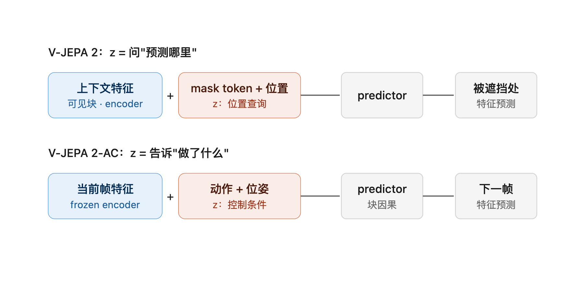
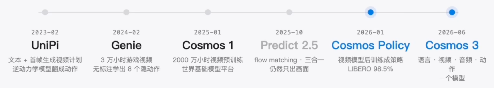
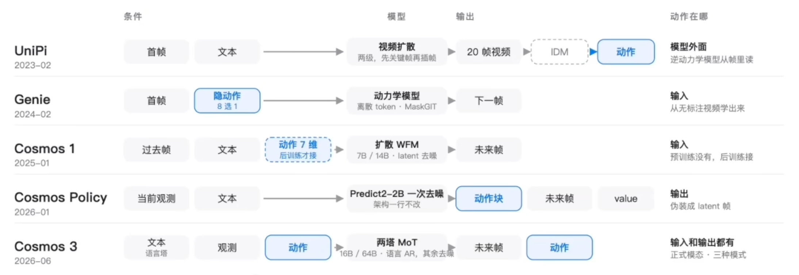

### 1、EgoX论文

egox是一个 video gen 模型，输入一段第三人称操作视频（exo video），生成这个人的第一人称操作视频。
首先会把 exo video 升维到 3d点云，然后给定一个轨迹，利用这个轨迹在点云中渲染一个 ego prior video，将 exo video 经过冻结的VAE后变为 $x_0$ latent，将 exo prior video经过 vae变为 $p_0$ ，待生成的第一人称latent是 $z_t$
- ego prior video 本来就是渲染的第一人称点云，所以很可能有破洞或者其他问题，但是他跟目标视角是齐平的，所以逐点对齐才有意义，ego prior video 的latent和 $z_t$ 在通道维度拼接
- ego video 和 要生成的第一人称视角就不是逐点对齐了，但是可以说 要生成的第一人称视角的很多信息需要从 ego video中查找，所以 $z_t$ 最好的做法是和 ego video 的latent 在宽度层面拼接，当作条件注入策略
修改Attention，改为 GGA 模式，利用第一人称视角下某一个 latent 的方向向量和第三人称下的方向做cos，让 cos 值大的 attention 更大

### JEPA

JEPA，首先看JE，联合嵌入，基本上就是对xy都encoder到latent中再去做预测。LeCun认为，如果直接在pixel层面的生成模型的话，必须把一些没用的像素也都画出来，容量和算力就被迫花在这些细节上，另外，对于下一状态应该是有很多种不同的表示，导致预测是容易生成平均的模糊的画面。
 
 $\hat{s}_y = P(s_x, z)$ 

因为 y 也需要经过 encoder，所以就容易造成，x和y的编码器都偷懒，都输出同一个常数。所以需要针对这个优化。
第一种的话就是，对比学习，通过提高负样本的数量（能量）。想 CLIP，SigLIP  其实不太支持，因为高维空间负样本量是巨大的

从结构入手，1、s_x 尽可能携带x的信息，s_y 尽可能携带y的信息，s_y必须是可以从 s_x预测的，z内容尽可能少 （z作为 predictor 的条件输入）

像是IJEPA还是VJEPA基本上都是用自监督的方法训的编码器（z是mask token），而后面的DINO-WM就是吧jepa的思想变成可交互的世界模型的一篇工作。

masked video作为 x ，使用 encoder，unmask video 作为 y，由于stop gradient，使用 ema方式从 x 的梯度中更新参数，作为 ema encoder。

VJEPA2 就是比较重要的，它分为两阶段训练了，第一个阶段也是训练一个 encoder，通过挖空的方式
- vjepa2 和 vjepa2-AC 使用的 z 不同，vjepa2 的z只是一个mask 的位置编码，而vjepa2AC的z是机器人动作（末端位姿、旋转、夹爪开合）和当前位姿【action-conditioned predictor】

### Cosmos

 genie给出的贡献可以理解为，他只输入视频和文本，通过将latent 的action 足够小，只有 8个32维的动作，让视频生成模型在预测下一帧的时候学会这些简单的动作

WAM
dreamZero · LingBot-VA · Cosmos policy

### VGGT 和 DA3

VGGT 的关键确实是 over-complete multi-task supervision，VGGT 各个 head 之间主要是通过共享 backbone 产生“软耦合”，不一定存在严格的跨 head 几何一致性约束。
